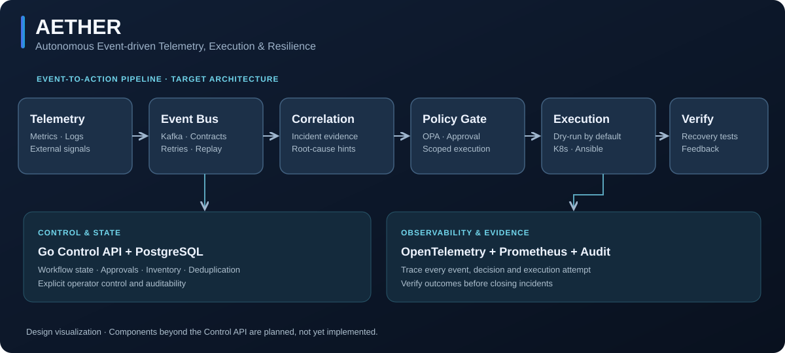
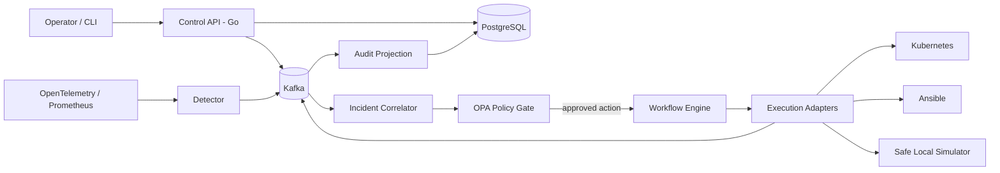

# AETHER
### Autonomous Event-driven Telemetry, Execution & Resilience

> **Status: Phase 0 — architecture and initial implementation.** AETHER is an experimental, local-first DevOps platform. Automated remediation is intentionally restricted to explicitly approved, allowlisted actions; this repository is not production-ready.

**AETHER** is an open-source engineering project exploring how observable infrastructure events can become auditable, policy-gated operational workflows. It is built around a service-oriented control plane rather than a single dashboard.

## Why this exists

Modern infrastructure produces alerts, logs and events, but humans often still have to correlate them, select a runbook, execute it and verify the result. AETHER aims to make this process reproducible: **observe → normalize → correlate → decide → approve → execute → verify → audit**.

### Design principles
- **Safety before autonomy**: start in dry-run mode; no destructive or production actions by default.
- **Events are not commands**: Kafka delivers facts, while a policy-controlled orchestrator authorizes commands.
- **State is explicit**: PostgreSQL stores workflow/incident state, Kafka distributes events, Redis is optional for ephemeral coordination.
- **Adapters over vendor lock-in**: execution backends can target Kubernetes, Ansible, Docker or cloud-compatible APIs.
- **Local-first**: Docker Compose and k3d/kind are development targets; Floci/LocalStack are optional integration-test dependencies.
- **Evidence over claims**: all features are labelled implemented, planned, or experimental.

## System overview

The visual below is the planned event-to-action pipeline; it does **not** imply the entire platform is implemented.

> Diagram describes **target architecture**, not a claim that all components are implemented.

## Initial repository layout

| Path | Purpose |
| --- | --- |
| `services/control-api/` | Go HTTP API and health endpoints |
| `docs/architecture/` | Architecture diagrams and decisions |
| `docs/roadmap.md` | Milestones and acceptance criteria |
| `contracts/events/` | Versioned event schemas |
| `deploy/compose/` | Local development infrastructure |
| `.github/workflows/` | CI automation |

## Planned implementation sequence

1. **Foundation** — documentation, architecture decisions, Go control API, tests and CI.
2. **Event fabric** — Kafka with structured event contracts, consumer idempotency and retry/DLQ semantics.
3. **Incident lifecycle** — PostgreSQL persistence, state machine, audit projection and correlation.
4. **Policy & execution** — authorization, dry-run engine, allowlisted adapters and approvals.
5. **Observability** — OpenTelemetry, Prometheus, Grafana, logging and SLOs.
6. **Delivery & resilience** — Kubernetes/Helm, GitOps, failure injection and measured recovery.

See [roadmap](docs/roadmap.md) and [architecture](docs/architecture/overview.md).

## Languages & technologies

Core services use **Go** (with room for Java/C++ adapters). Infrastructure uses Docker, Kubernetes, Kafka, PostgreSQL, OpenTofu/Terraform and Ansible as milestones are implemented. Optional local cloud emulators are **not prerequisites** for development.

## Safety and scope

Do not expose this prototype directly to the public internet. Credentials, access controls, persistence, policy enforcement and execution isolation require hardening. AETHER does not run privileged remediation automatically without explicit policy and operator approval.

## Contributing

See [CONTRIBUTING.md](CONTRIBUTING.md). Architecture decisions should be documented before changing cross-service contracts.

## License

Apache License 2.0 — see [LICENSE](LICENSE).
