# AETHER
### Autonomous Event-driven Telemetry, Execution & Resilience

[](https://github.com/ABHILASH9519/Project-Aether-Autonomous-Infrastructure-Orchestrator/actions/workflows/event-fabric.yml) [](https://github.com/ABHILASH9519/Project-Aether-Autonomous-Infrastructure-Orchestrator/actions/workflows/kubernetes.yml) [](https://github.com/ABHILASH9519/Project-Aether-Autonomous-Infrastructure-Orchestrator/actions/workflows/gitops.yml) [](https://github.com/ABHILASH9519/Project-Aether-Autonomous-Infrastructure-Orchestrator/actions/workflows/automation.yml) [](https://github.com/ABHILASH9519/Project-Aether-Autonomous-Infrastructure-Orchestrator/actions/workflows/supply-chain.yml) [](https://github.com/ABHILASH9519/Project-Aether-Autonomous-Infrastructure-Orchestrator/actions/workflows/control-api.yml)

[Architecture](#system-overview) · [Quick start](#quick-start-local-lab) · [Verification](#verification-matrix) · [Measured performance](#performance-testing) · [Operator demo](docs/runbooks/operator-demo.md)

> **Status: integrated local engineering lab — durable workflows, policy gates, remediation, observability and GitOps.** AETHER is an experimental, local-first DevOps platform. Automated remediation is intentionally restricted to explicitly approved, allowlisted actions; this repository is not production-ready.

**AETHER** is an open-source engineering project exploring how observable infrastructure events can become auditable, policy-gated operational workflows. It is built around a service-oriented control plane rather than a single dashboard.

## What AETHER delivers

| Capability | Implementation |
| --- | --- |
| Event-driven ingestion | Go + Kafka, Redis admission control, durable PostgreSQL inbox/outbox |
| Safe remediation | OPA policy, distinct approval roles, optimistic version checks, bounded retries and verified synthetic fixtures |
| Infrastructure automation | Ansible and Puppet reconciliation, Helm, kind, Argo CD drift recovery and immutable local OCI image delivery |
| Observability | Prometheus histograms and alert rules, Grafana, Jaeger across durable queues |
| Resilience | Duplicate-event suppression, dependency outage drills, retained PVCs and logical database restore |
| Engineering evidence | Race tests, integration CI, measured load report, CycloneDX SBOM and vulnerability triage |

**Verified baseline:** [Event fabric](https://github.com/ABHILASH9519/Project-Aether-Autonomous-Infrastructure-Orchestrator/actions/runs/46067786876) · [Immutable GitOps](https://github.com/ABHILASH9519/Project-Aether-Autonomous-Infrastructure-Orchestrator/actions/runs/46067787051) · [Kubernetes](https://github.com/ABHILASH9519/Project-Aether-Autonomous-Infrastructure-Orchestrator/actions/runs/46067477316) · [Security report](https://github.com/ABHILASH9519/Project-Aether-Autonomous-Infrastructure-Orchestrator/actions/runs/46067342671). CLI, audit and automatic evidence delivery passed in [run 46131801803](https://github.com/ABHILASH9519/Project-Aether-Autonomous-Infrastructure-Orchestrator/actions/runs/46131801803). AETHER is a local lab, not a production automation product.

## Quick start (local lab)

```bash
export AETHER_OPERATOR_TOKEN="$(openssl rand -hex 32)"
export AETHER_APPROVER_TOKEN="$(openssl rand -hex 32)"
make up
# Wait for both APIs to report readiness.
make ready
make demo
# Optional expanded integration and automation checks:
make smoke
make automation
# Stop when finished (retains named volumes).
make down
```

For a concise recorded walkthrough, use the [operator demo](docs/runbooks/operator-demo.md). The CLI demonstrates a real synthetic repair and the ordered audit trail through actual APIs. See [local demo runbook](docs/runbooks/local-demo.md) for prerequisites, limitations and cleanup. See the verification matrix below for the last successful runs and remaining checks. Do not expose local ports publicly.

## Why this exists

Modern infrastructure produces alerts, logs and events, but humans often still have to correlate them, select a runbook, execute it and verify the result. AETHER aims to make this process reproducible: **observe → normalize → correlate → decide → approve → execute → verify → audit**.

### Design principles
- **Safety before autonomy**: start in dry-run mode; no destructive or production actions by default.
- **Events are not commands**: Kafka delivers facts, while a policy-controlled orchestrator authorizes commands.
- **State is explicit**: PostgreSQL stores workflow/incident state, Kafka distributes events, Redis is optional for ephemeral coordination.
- **Adapters over vendor lock-in**: execution backends can target Kubernetes, Ansible, Docker or cloud-compatible APIs.
- **Local-first**: Docker Compose and k3d/kind are development targets; Floci/LocalStack are optional integration-test dependencies.
- **Evidence over claims**: all features are labelled implemented, planned, or experimental.

## System overview

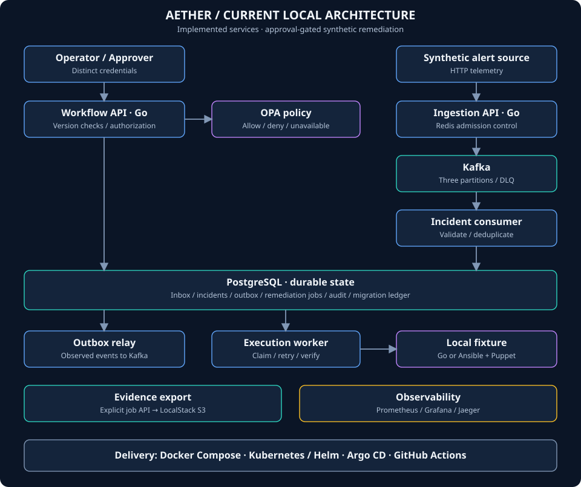

The current implementation is shown above. The original target architecture below is retained for historical context.


The visual below is the planned event-to-action pipeline; it does **not** imply the entire platform is implemented.


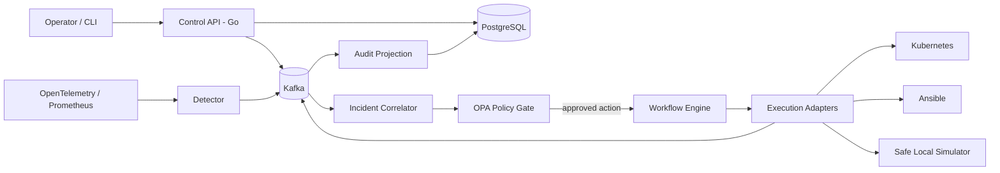

> Diagram describes **target architecture**, not a claim that all components are implemented.

## Repository layout

| Path | Purpose |
| --- | --- |
| `services/control-api/` | Go HTTP API and health endpoints |
| `services/event-fabric/` | Six Go processes, persistence, policy and telemetry |
| `automation/` | Ansible/Puppet reconciliation adapters |
| `deploy/helm/`, `deploy/gitops/` | Kubernetes and Argo CD |
| `deploy/observability/` | Prometheus and Grafana |
| `tests/` | Integration and recovery drills |
| `docs/architecture/` | Architecture diagrams and decisions |
| `docs/roadmap.md` | Milestones and acceptance criteria |
| `contracts/events/` | Versioned event schemas |
| `deploy/compose/` | Local development infrastructure |
| `.github/workflows/` | CI automation |

## Planned implementation sequence

1. **Foundation** — documentation, architecture decisions, Go control API, tests and CI.
2. **Event fabric** — Kafka with structured event contracts, consumer idempotency and retry/DLQ semantics.
3. **Incident lifecycle** — PostgreSQL persistence, state machine, audit projection and correlation.
4. **Policy & execution** — authorization, dry-run engine, allowlisted adapters and approvals.
5. **Observability** — OpenTelemetry, Prometheus, Grafana, logging and SLOs.
6. **Delivery & resilience** — Kubernetes/Helm, GitOps, failure injection and measured recovery.

See [roadmap](docs/roadmap.md) and [architecture](docs/architecture/overview.md).

## Languages & technologies

Core services use **Go** (with room for Java/C++ adapters). Infrastructure uses Docker, Kubernetes, Kafka, PostgreSQL, OpenTofu/Terraform and Ansible as milestones are implemented. Optional local cloud emulators are **not prerequisites** for development.

## Safety and scope

Do not expose this prototype directly to the public internet. Credentials, access controls, persistence, policy enforcement and execution isolation require hardening. AETHER does not run privileged remediation automatically without explicit policy and operator approval.

## Contributing

See [CONTRIBUTING.md](CONTRIBUTING.md). Architecture decisions should be documented before changing cross-service contracts.

## License

Apache License 2.0 — see [LICENSE](LICENSE).

## Event fabric preview (Phase 2)

The Go ingestion and consumer processes, Kafka Compose environment and smoke test are available on main. Prior CI verified the event fabric. See [event fabric architecture and local run instructions](docs/architecture/event-fabric.md).

### Event ingestion and processing flow

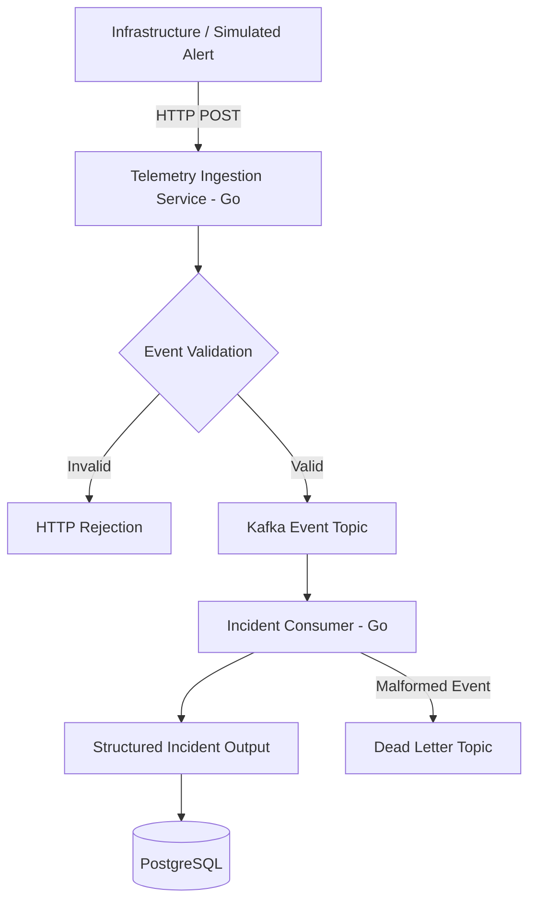

### Kafka architecture

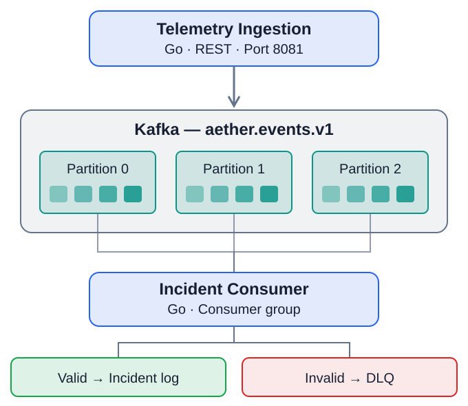

*Implemented event-processing design; prior integration CI passed.*

Events are routed using their correlation IDs as partition keys. Malformed broker messages are sent to a dead-letter topic before their consumer offsets are committed.

### Overall AETHER development roadmap

| Phase | Milestone | Status |
| --- | --- | --- |
| 01 | Repository, architecture and control API | Committed |
| 02 | Kafka event fabric | Prior end-to-end CI passed |
| 03 | PostgreSQL incident management | Prior PostgreSQL and workflow integration CI passed |
| 04 | Redis caching and coordination | Shared admission budget; prior integration CI passed |
| 05 | Workflow orchestration and policy engine | OPA and default lab execution verified in prior CI |
| 06 | Ansible and Puppet automation | Standalone and approved Ansible/Puppet adapter CI passed |
| 07 | Floci / LocalStack cloud adapters | LocalStack S3 evidence round-trip CI passed |
| 08 | Kubernetes, Helm and GitOps | Helm/kind and Argo CD sync/self-healing CI passed |
| 09 | Prometheus, Grafana and OpenTelemetry | HTTP metrics, dashboard and HTTP-to-Kafka tracing verified in prior CI |
| 10 | Chaos engineering and security | OPA and Redis outage drills CI passed; broader chaos/security pending |

## Durable event processing

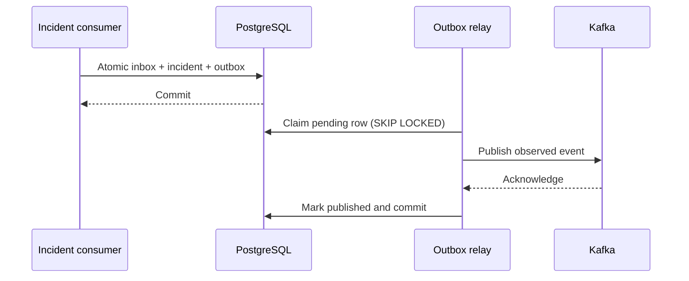

**Guarantee:** at-least-once delivery with transactional inbox deduplication. No end-to-end exactly-once claim. See [failure model](docs/architecture/outbox-relay.md). Prior integration CI passed.

## Approval-gated incident lifecycle

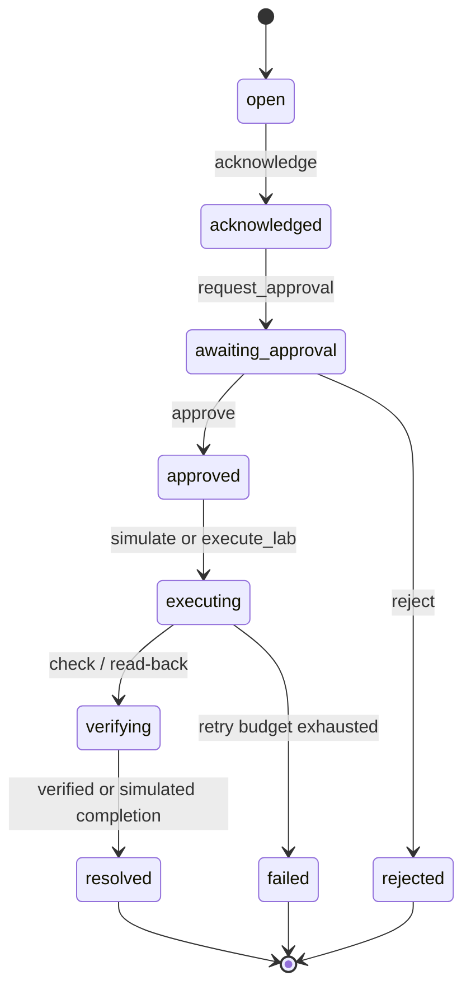

The opt-in workflow API uses distinct operator/approver bearer tokens, OPA authorization, version checks and atomic audit inserts. The simulate command records simulated steps only; execute_lab enqueues an approved synthetic repair. Failed jobs terminate after the retry budget is exhausted. See [workflow architecture and limitations](docs/architecture/workflow.md).

```bash
export AETHER_OPERATOR_TOKEN="$(openssl rand -hex 32)"
export AETHER_APPROVER_TOKEN="$(openssl rand -hex 32)"
docker compose -f deploy/compose/events.yaml --profile workflow up -d --build
bash tests/event-fabric-smoke.sh
bash tests/workflow-smoke.sh
```

**Verification:** [GitHub Actions run 45892838506](https://github.com/ABHILASH9519/Project-Aether-Autonomous-Infrastructure-Orchestrator/actions/runs/45892838506) passed the prior Kafka/PostgreSQL/Docker workflow baseline. [Run 45893095275](https://github.com/ABHILASH9519/Project-Aether-Autonomous-Infrastructure-Orchestrator/actions/runs/45893095275) also passed Redis and monitoring checks. OPA authorization and recovery also passed in run 45894817663. No production deployment or real remediation is supported yet.

## Admission control and observability

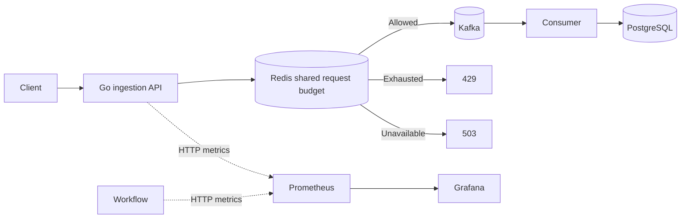

```bash
export AETHER_OPERATOR_TOKEN="$(openssl rand -hex 32)"
export AETHER_APPROVER_TOKEN="$(openssl rand -hex 32)"
docker compose -f deploy/compose/events.yaml --profile workflow --profile observability up -d --build
```

- Redis admission: 120 requests per fixed 60-second window shared by ingestion replicas; fail closed on Redis failure.
- Prometheus: http://localhost:9090
- Grafana: http://localhost:3000 (local anonymous viewer, provisioned AETHER HTTP operations dashboard)
- Metrics: http://localhost:8081/metrics and http://localhost:8082/metrics

See [admission design](docs/architecture/admission.md) and [observability design](docs/architecture/observability.md). Metrics do not contain request IDs or payloads. The optional monitoring profile is local only; prior monitoring smoke tests passed. HTTP-to-Kafka OpenTelemetry tracing is now optional; durable queue metrics, latency histograms and local alert rules are now included.

## Policy-based authorization


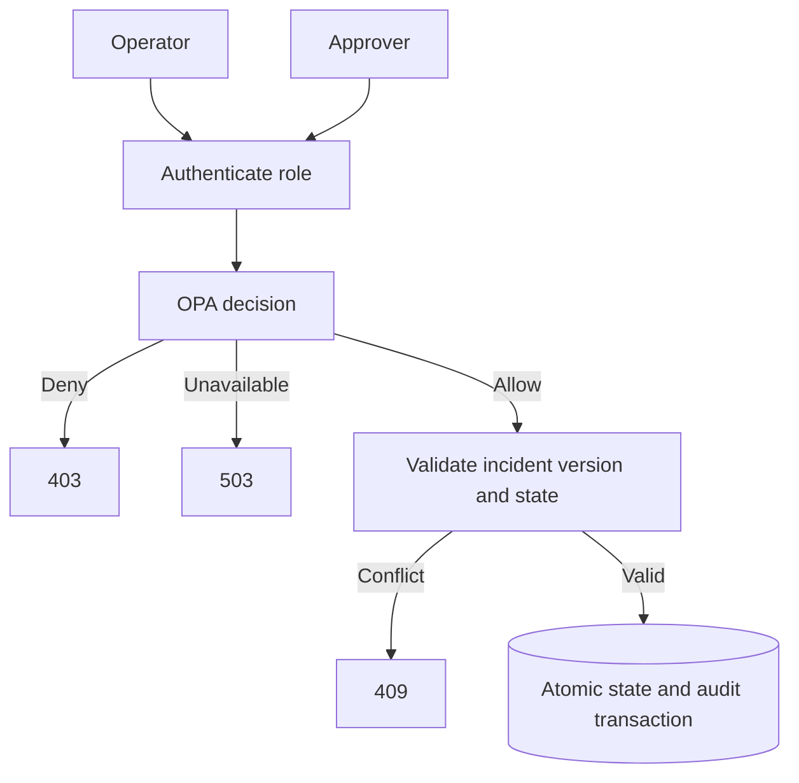


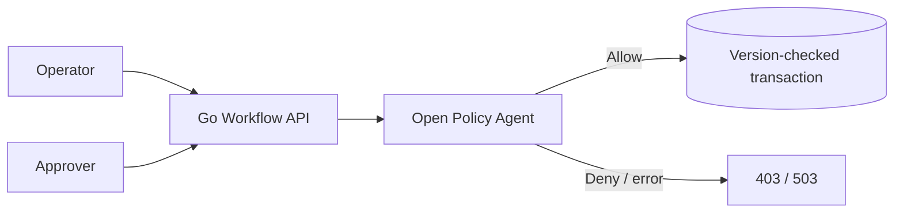

Operators acknowledge, request approval, simulate or queue an approved lab repair; approvers approve or reject. OPA denies unknown actions and live execution. See [policy architecture](docs/architecture/policy.md). Two distinct tokens are required for the workflow profile. [Policy and outage integration CI passed](https://github.com/ABHILASH9519/Project-Aether-Autonomous-Infrastructure-Orchestrator/actions/runs/45894817663). Audit rows record the server-derived role. See the [local OPA outage drill](docs/runbooks/policy-outage.md) for fail-closed behavior and recovery.

## Durable lab execution

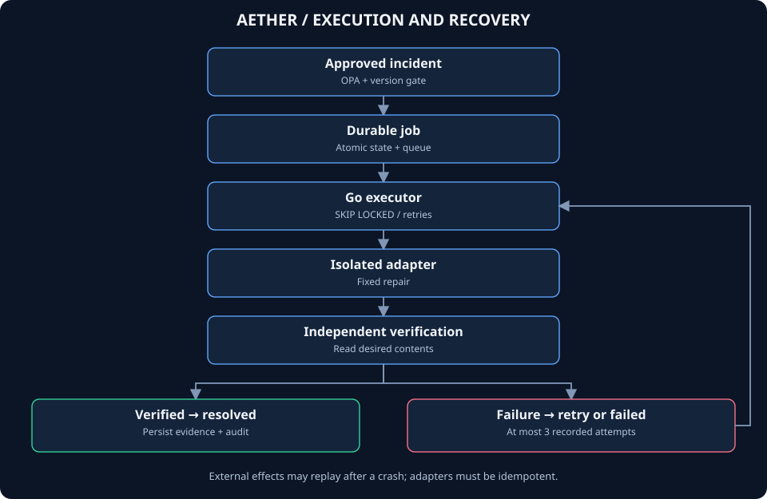

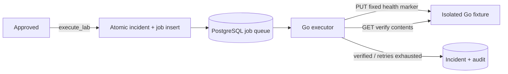

The `execute_lab` action queues an approved job. A separate worker applies an idempotent repair to an isolated synthetic fixture and independently verifies the contents. Three recorded attempts are allowed. Fixture state is ephemeral; this is not real production infrastructure remediation. See [execution architecture](docs/architecture/execution.md). Inspect job evidence via authenticated `GET /api/v1/incidents/{id}/job`. Run `bash tests/execution-smoke.sh` with the workflow profile. Default fixture execution passed in run 45897898366; the approved Ansible/Puppet adapter passed in run 45898190166.

## Configuration management lab


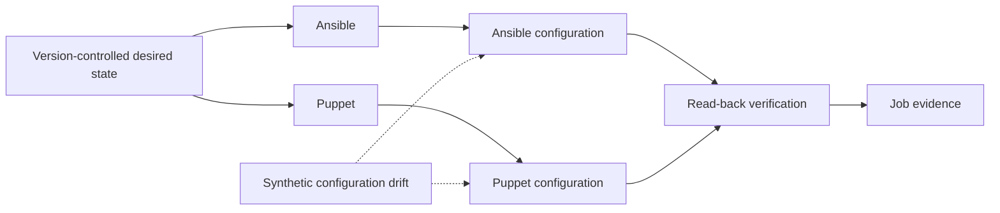


Ansible and Puppet enforce a version-controlled desired configuration, demonstrate idempotence, and correct injected drift inside a disposable container. See [architecture and run instructions](docs/architecture/configuration-management.md). An optional Compose overlay connects a fixed Ansible/Puppet reconciliation adapter to the approved execution worker; see the linked guide.

## Kubernetes deployment


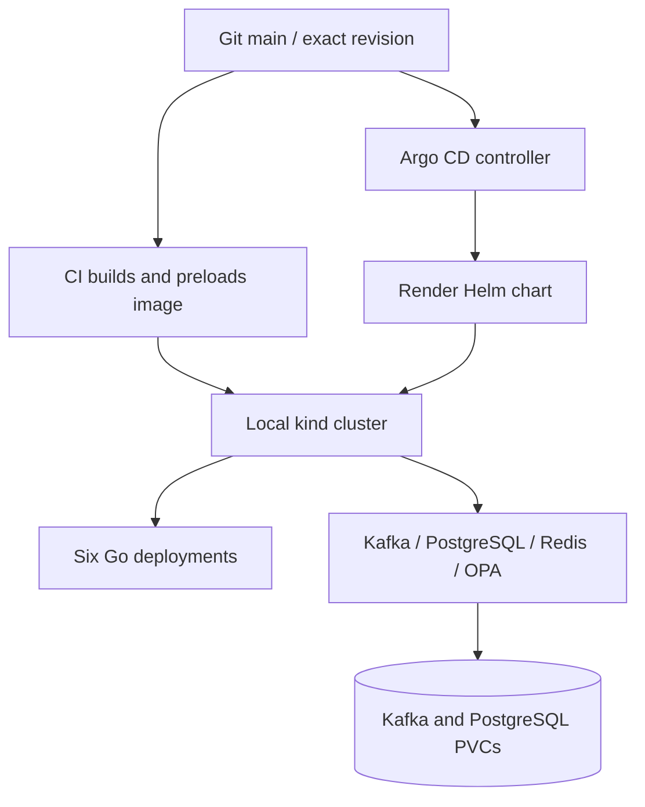


A local Helm chart deploys the six event-fabric processes and their dependencies; a kind CI job checks the approved workflow and lab repair. An Argo CD Application with automatic sync and self-healing, a scoped AppProject, and a dedicated GitOps integration workflow are included. See [Kubernetes architecture and setup](docs/architecture/kubernetes.md). The chart now uses separate PostgreSQL and Kafka persistent volume claims by default; pod replacement recovery testing passed in CI. Images remain locally loaded, not registry-promoted.

## Distributed tracing


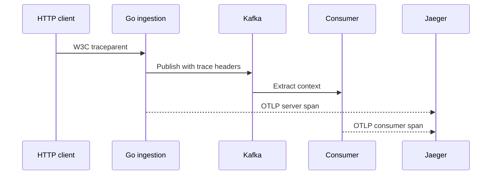


Set `AETHER_OTLP_ENDPOINT=http://jaeger:4318/v1/traces` before starting the observability profile. Jaeger listens on http://localhost:16686. W3C trace headers connect HTTP ingestion to Kafka consumer spans. See [trace architecture](docs/architecture/tracing.md). HTTP-to-Kafka tracing passed in run 45897963370; the relay and execution worker now resume persisted trace context through migration 2; new CI verification pending.

## Local cloud evidence archive


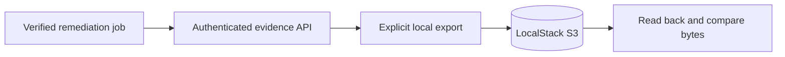


The opt-in `cloud` Compose profile uses LocalStack S3 to archive verified remediation evidence. The smoke script exports authenticated job metadata and checks a byte-for-byte download. See [local cloud lab](docs/architecture/cloud-evidence.md). This is an explicit lab export, not continuous cloud archival; no live AWS account is required.

## Failure drills


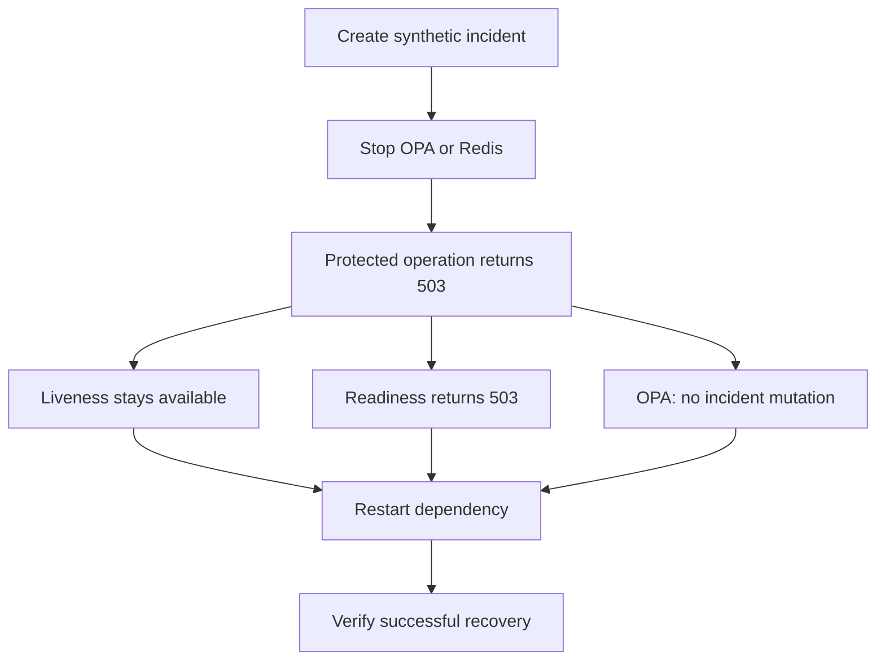


The local suite includes [OPA outage and recovery](docs/runbooks/policy-outage.md) and [Redis fail-closed outage and recovery](docs/runbooks/redis-outage.md). These deliberately stop disposable local services; never run them against production.

## Verification matrix

| Scope | Verified commit / run |
| --- | --- |
| Default execution and retry tests | [ba06c97 / CI](https://github.com/ABHILASH9519/Project-Aether-Autonomous-Infrastructure-Orchestrator/actions/runs/45897898366) |
| HTTP-to-Kafka trace propagation | [29462c9 / CI](https://github.com/ABHILASH9519/Project-Aether-Autonomous-Infrastructure-Orchestrator/actions/runs/45897963370) |
| Local Kubernetes workflow and execution | [ba06c97 / CI](https://github.com/ABHILASH9519/Project-Aether-Autonomous-Infrastructure-Orchestrator/actions/runs/45897898363) |
| Standalone Ansible/Puppet drift reconciliation | [11750b4 / CI](https://github.com/ABHILASH9519/Project-Aether-Autonomous-Infrastructure-Orchestrator/actions/runs/45898062606) |
| LocalStack evidence export | [ada3bfb / CI](https://github.com/ABHILASH9519/Project-Aether-Autonomous-Infrastructure-Orchestrator/actions/runs/45898190136) |
| Redis outage recovery and cloud smoke | [ada3bfb / CI](https://github.com/ABHILASH9519/Project-Aether-Autonomous-Infrastructure-Orchestrator/actions/runs/45898190136) |
| Approved Ansible/Puppet adapter | [ada3bfb / CI](https://github.com/ABHILASH9519/Project-Aether-Autonomous-Infrastructure-Orchestrator/actions/runs/45898190166) |
| Argo CD sync and replica self-healing | [34e1f7d / CI](https://github.com/ABHILASH9519/Project-Aether-Autonomous-Infrastructure-Orchestrator/actions/runs/45901613370) |
| Kubernetes PVC pod replacement | [8da6c30 / CI](https://github.com/ABHILASH9519/Project-Aether-Autonomous-Infrastructure-Orchestrator/actions/runs/46064413429) |
| PostgreSQL logical restore | [7456210 / CI](https://github.com/ABHILASH9519/Project-Aether-Autonomous-Infrastructure-Orchestrator/actions/runs/46064464894) |
| Versioned migrations | [9b66efc / CI](https://github.com/ABHILASH9519/Project-Aether-Autonomous-Infrastructure-Orchestrator/actions/runs/46064513027) |
| Dependency readiness and outage drills | [49dbcc6 / CI](https://github.com/ABHILASH9519/Project-Aether-Autonomous-Infrastructure-Orchestrator/actions/runs/46064602921) |
| GitOps with PVCs | [ba63e6a / CI](https://github.com/ABHILASH9519/Project-Aether-Autonomous-Infrastructure-Orchestrator/actions/runs/46064370803) |
| Latency histograms and monitoring | [1cd852d / CI](https://github.com/ABHILASH9519/Project-Aether-Autonomous-Infrastructure-Orchestrator/actions/runs/46065272531) |
| Argo CD initialization fix and full sync | [1cd852d / CI](https://github.com/ABHILASH9519/Project-Aether-Autonomous-Infrastructure-Orchestrator/actions/runs/46065272634) |

These runs validate particular commits, not every later change. The project remains a local engineering lab; production HA, identity, node-loss recovery, live cloud execution, full trace coverage and registry-based image promotion remain outside the verified scope.

## GitOps reconciliation


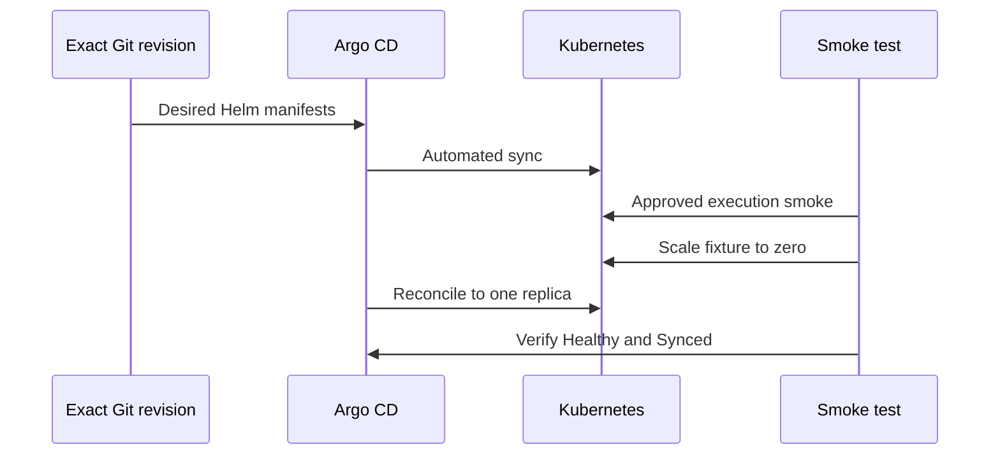


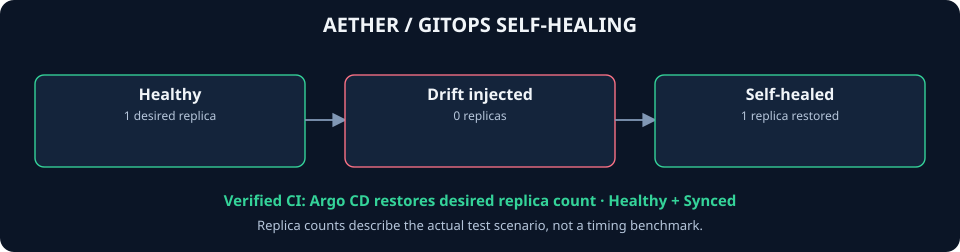

The dedicated Argo CD workflow installs a pinned controller, deploys the exact commit through Git (not Helm install), runs approval and execution smoke tests, and checks recovery from replica drift. See [GitOps architecture and local setup](docs/architecture/gitops.md). Automated pruning is disabled. Controller integration passed in [run 45901613370](https://github.com/ABHILASH9519/Project-Aether-Autonomous-Infrastructure-Orchestrator/actions/runs/45901613370): the exact Git revision synced successfully, the approved workflow completed, and Argo CD restored the fixture from zero to one replica.

## Kubernetes persistence


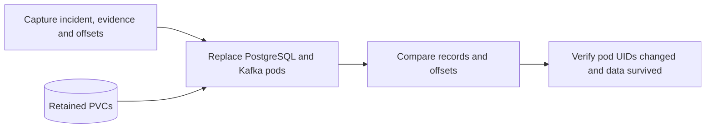


The Helm chart now provisions PostgreSQL and Kafka PVCs by default. Use a fresh namespace when switching from the previous emptyDir setup; no automatic data migration is provided. Claims are retained on Helm uninstall and excluded from Argo CD prune/delete. Deleting a namespace can still destroy data. Single-node storage is not HA or backup. See [Kubernetes guide](docs/architecture/kubernetes.md).

The [persistence recovery drill](docs/runbooks/kubernetes-persistence.md) compares incident/job state and Kafka partition end offsets before and after real pod replacement. [Persistence CI passed](https://github.com/ABHILASH9519/Project-Aether-Autonomous-Infrastructure-Orchestrator/actions/runs/46064413429).

## Database recovery


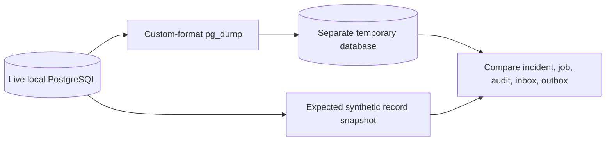


The [PostgreSQL restore drill](docs/runbooks/postgres-restore.md) creates a logical backup and restores it into a separate temporary database. It checks the incident, remediation evidence, audit, inbox and outbox records without overwriting the source. This local test is not a coordinated Kafka/PostgreSQL recovery plan. [Restore CI passed](https://github.com/ABHILASH9519/Project-Aether-Autonomous-Infrastructure-Orchestrator/actions/runs/46064464894).

## Schema lifecycle


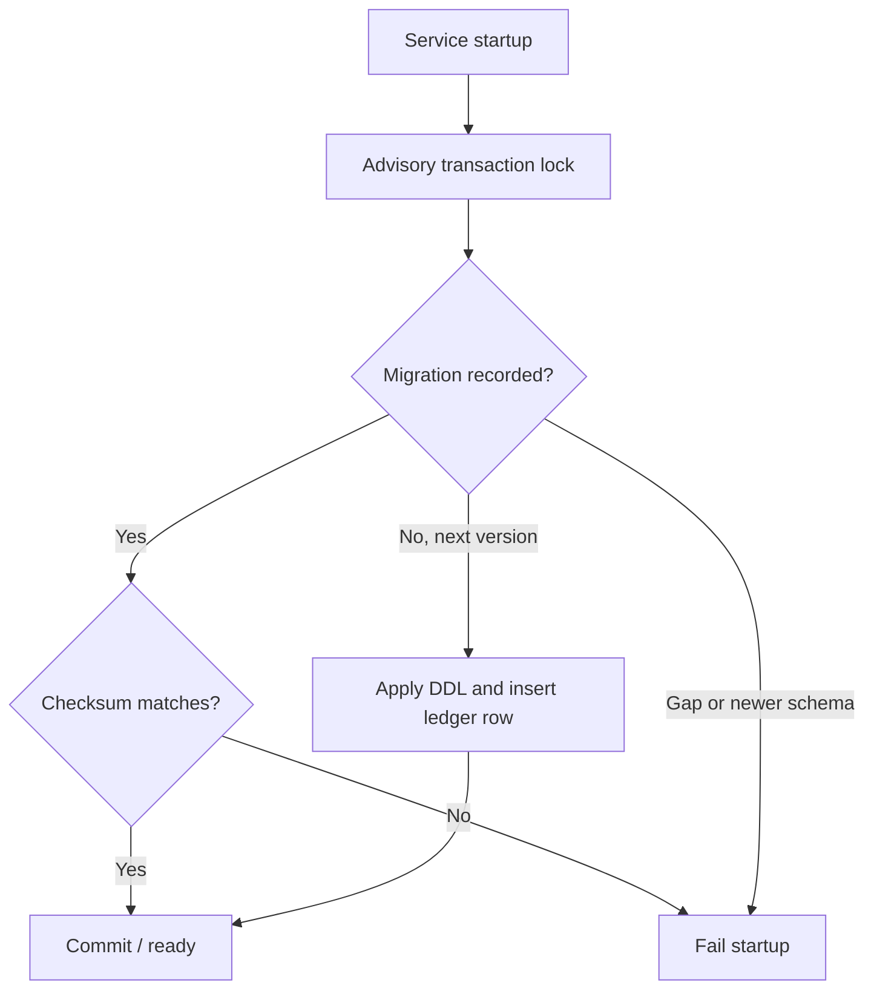


An ordered, checksummed [migration ledger](docs/architecture/migrations.md) now prevents repeated DDL on service startup, serializes concurrent replicas and rejects schema checksum mismatches. [Concurrent migration CI passed](https://github.com/ABHILASH9519/Project-Aether-Autonomous-Infrastructure-Orchestrator/actions/runs/46064513027).

## Dependency-aware readiness


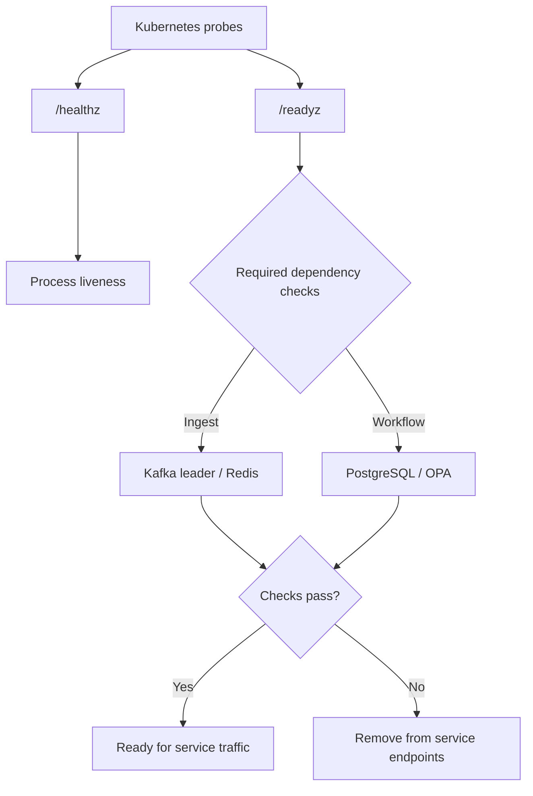


Ingest and workflow expose `/readyz` separately from process liveness `/healthz`. Ingest checks a Kafka partition leader and optional Redis; workflow checks PostgreSQL and an OPA decision. Kubernetes removes unready API pods from Service endpoints without restarting a healthy process solely because a dependency is down. The outage drills assert liveness remains available and readiness returns 503. Readiness is a point-in-time sample, not a guarantee of all partitions or future request success. [Readiness/outage CI passed](https://github.com/ABHILASH9519/Project-Aether-Autonomous-Infrastructure-Orchestrator/actions/runs/46064602921).

## Kafka replay safety


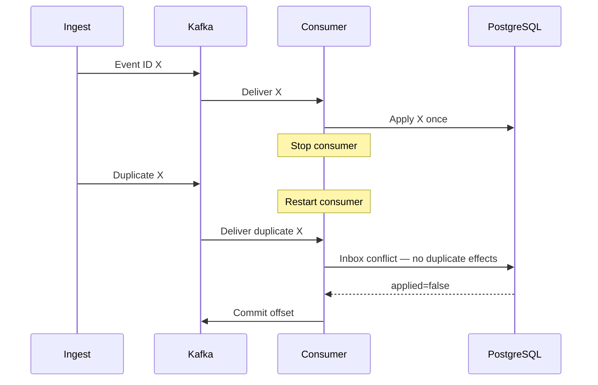


A new [consumer restart and duplicate-event drill](docs/runbooks/kafka-replay.md) verifies a replayed event has only one inbox/outbox effect. PostgreSQL concurrency coverage also races 32 writes across eight unique IDs and checks the incident projection. These targeted at-least-once invariants passed in [CI run 46064765194](https://github.com/ABHILASH9519/Project-Aether-Autonomous-Infrastructure-Orchestrator/actions/runs/46064765194).

## Kubernetes network isolation


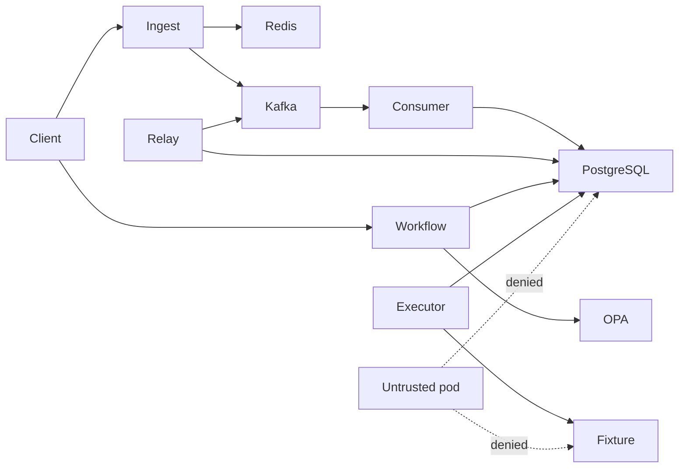


The Helm chart includes a default-deny ingress policy with explicit backend allowlists. Ingest/workflow remain reachable on their API ports. A dedicated smoke test checks unauthorized pod access against actual ready backend IPs, while the ordinary workflow tests exercise permitted connections. Requires a NetworkPolicy-capable CNI; egress is not restricted. See [network design](docs/architecture/network-isolation.md). [Network isolation CI passed](https://github.com/ABHILASH9519/Project-Aether-Autonomous-Infrastructure-Orchestrator/actions/runs/46064820320).

## Queue observability and alerts

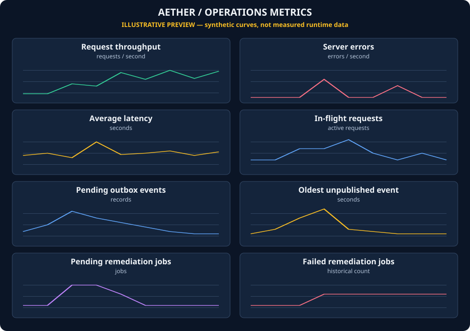

*Illustrative curves only, not CI measurements or live Grafana screenshots. The committed Grafana dashboard contains HTTP, pending-work and oldest-outbox panels; the dashboard also includes the failed-job count and new percentile panels.*

Workflow metrics now expose durable queue depth, oldest unpublished age and remediation failure counts, with explicit collection health. Grafana includes queue panels and Prometheus evaluates stalled-outbox and unavailable-collector alerts. [Design and limits](docs/architecture/queue-observability.md). Alertmanager notification delivery is not configured; [queue monitoring CI passed](https://github.com/ABHILASH9519/Project-Aether-Autonomous-Infrastructure-Orchestrator/actions/runs/46064895229). Histogram integration subsequently passed.

### Latency distribution

HTTP request latency is now exported as a cumulative Prometheus histogram, with fixed buckets and bounded status-class labels. Grafana adds p50/p95/p99 estimates and historical failed-job count. Percentiles are estimates from buckets, not exact per-request measurements. Histogram integration passed in [run 46065272531](https://github.com/ABHILASH9519/Project-Aether-Autonomous-Infrastructure-Orchestrator/actions/runs/46065272531); no benchmark results are claimed.

## Immutable image delivery

```mermaid
flowchart LR
 Git[Exact source commit] --> Build[Docker image build]
 Build --> Registry[(Local OCI registry)]
 Registry --> Digest[Resolve manifest digest]
 Digest --> Argo[Argo CD Helm parameters]
 Git --> Argo
 Argo --> Pods[Six digest-pinned workloads]
 Pods --> Verify[Check image references and readiness]

```

GitOps CI now builds, pushes and resolves an image digest through a disposable local registry. Argo CD deploys the exact digest and tests all six workloads. Default Helm remains compatible with local preloaded images. See [image delivery design](docs/architecture/image-delivery.md). The first registry CI push succeeded but manifest negotiation failed; lookup now handles indexes and single-image manifests and verifies the returned SHA-256. Corrected CI pending. No external registry publication is performed.

## Performance testing

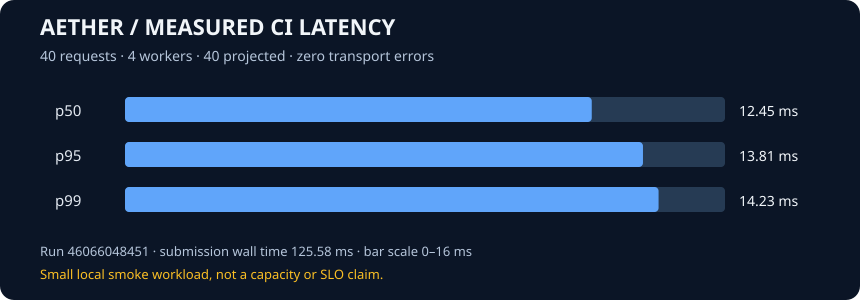

[Raw measured report](docs/benchmarks/ci-46066048451.json) · [CI source](https://github.com/ABHILASH9519/Project-Aether-Autonomous-Infrastructure-Orchestrator/actions/runs/46066048451). The 40-event, four-worker smoke workload accepted and projected all events. These are measured client response times on that CI runner, not production capacity.

```mermaid
flowchart LR
 Load[Bounded Go load generator] --> Ingest[HTTP ingestion]
 Ingest --> Kafka --> Consumer --> DB[(Incident projection)]
 DB --> Check[Verify all events projected]
 Ingest --> Report[Measured p50 / p95 / p99]
 Check --> Report
```

Run `make load` against a ready local stack. The Go generator measures actual HTTP response latency and verifies the event count; CI uploads the JSON report. This is a bounded smoke benchmark, not a throughput or production SLO claim. See [load test runbook](docs/runbooks/load-testing.md). The initial load and projection test passed in the linked run.

## Supply-chain security evidence

```mermaid
flowchart LR
 Git[Source revision] --> Modules[Go module verification]
 Git --> Build[Container build]
 Build --> Archive[Exported image archive]
 Archive --> Scan[Trivy scanner]
 Scan --> SBOM[CycloneDX SBOM]
 Scan --> CVE[High / critical findings report]
 Modules --> Artifact[CI evidence artifact]
 SBOM --> Artifact
 CVE --> Artifact
```

The [supply-chain workflow](.github/workflows/supply-chain.yml) records Go dependency inventory, image metadata, an SBOM and a vulnerability report. The current scan is report-only, not a release gate. [Initial scan](https://github.com/ABHILASH9519/Project-Aether-Autonomous-Infrastructure-Orchestrator/actions/runs/46065864664) generated both reports and found 8 critical and 181 high-severity entries; remediation is required. Go module checksums generated by that run are committed; builds now enforce readonly resolution and tidy checks. See [security evidence scope](docs/architecture/supply-chain.md). Readonly dependency builds passed in CI.

### Alert rule regression tests

Promtool now evaluates synthetic time series to check the one-minute alert delay, firing conditions, and recovery of the outbox, database collection and workflow scrape alerts. Synthetic time series are test fixtures, not measured production data. New CI pending.

### Durable trace context

```mermaid
flowchart LR
 HTTP[Ingest HTTP span] --> Kafka --> Consume[Consumer span]
 Consume --> Outbox[(Outbox traceparent)] --> Relay[Relay producer span]
 Command[Workflow transition span] --> Job[(Job traceparent)] --> Executor[Remediation attempt span]
 Relay -. OTLP .-> Jaeger
 Executor -. OTLP .-> Jaeger
```

Two independent causal traces now cross durable PostgreSQL queue boundaries. No baggage, credentials or event payload is persisted as tracing metadata. Jaeger smoke tests verified relay and execution spans in run 46067342592. Fixture HTTP and policy spans are not yet instrumented. See [trace design](docs/architecture/tracing.md).

### Security remediation baseline

Container builders and Go CI now target Go 1.26.11, a supported security-patched release ([upstream release history](https://go.dev/doc/devel/release)). The module's minimum Go language version is unchanged. The scan emits deduplicated package/CVE triage and available fixed versions for follow-up upgrades. This is the first mitigation step, not a claim that all 189 earlier findings are resolved. The [follow-up scan](https://github.com/ABHILASH9519/Project-Aether-Autonomous-Infrastructure-Orchestrator/actions/runs/46067342671) found 5 critical and 75 high entries, versus 8 and 181 previously. Remaining vulnerabilities require remediation.

Registry integration follow-up: manifest verification passed, but node image pulls failed due to the loopback alias. The GitOps workflow now explicitly configures the containerd CRI registry path and verifies each node can pull the digest before Argo CD installation. Full registry-based GitOps CI passed in [run 46067477513](https://github.com/ABHILASH9519/Project-Aether-Autonomous-Infrastructure-Orchestrator/actions/runs/46067477513).

## CI failure analysis

See [CI triage runbook](docs/runbooks/ci-triage.md) for failed-run evidence, root causes and verified corrections. The corrected Go tracing and read-only build passed; Full registry-based GitOps CI passed in [run 46067477513](https://github.com/ABHILASH9519/Project-Aether-Autonomous-Infrastructure-Orchestrator/actions/runs/46067477513). Integration jobs now wait for source-level tests, and GitOps failure diagnostics collect controller and registry evidence. Historical red runs remain immutable.

### CI validation sequence

```mermaid
flowchart TD
 Commit[Commit to main] --> Verify[Verify dependencies]
 Verify --> Test[Go race tests]
 Test --> Build[Go vet and build]
 Build --> Gate{Source checks pass?}
 Gate -->|Yes| Integration[Docker integration]
 Gate -->|No| Fail[Fail without redundant build]
 Integration --> Result{Integration passes?}
 Result -->|Yes| Success[Successful CI]
 Result -->|No| Diagnostics[Preserve failure and collect evidence]
```

### Measured security scan comparison

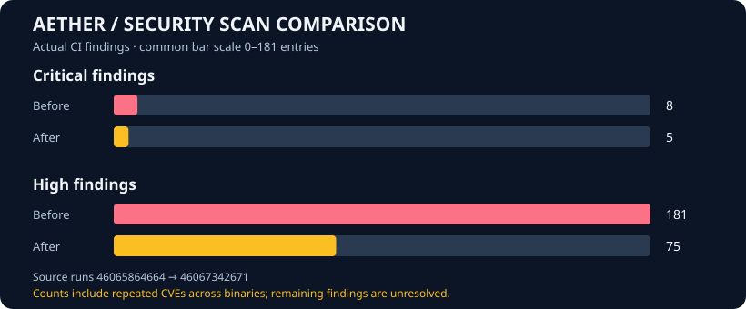

[Initial scan](https://github.com/ABHILASH9519/Project-Aether-Autonomous-Infrastructure-Orchestrator/actions/runs/46065864664) and [follow-up scan](https://github.com/ABHILASH9519/Project-Aether-Autonomous-Infrastructure-Orchestrator/actions/runs/46067342671). Counts are scanner result entries, not unique CVEs or a security clearance. Remaining findings require dependency remediation.

### Auditable operator experience

Authenticated `GET /api/v1/incidents/{id}/audit?after=0` returns the ordered transition history, including actor role, previous/next state, version and timestamp. Pages are limited to 100 entries; `next_after` is a continuation cursor. The execution smoke test verifies the six expected transitions and credential enforcement. [Audit integration passed](https://github.com/ABHILASH9519/Project-Aether-Autonomous-Infrastructure-Orchestrator/actions/runs/46131801803). Roles identify shared lab credentials, not individual people.

### Operator CLI

```mermaid
sequenceDiagram
 participant CLI as aetherctl
 participant I as Ingest API
 participant W as Workflow API
 participant E as Executor
 CLI->>I: Synthetic alert
 CLI->>W: Check incident and blocked early execution
 CLI->>W: Operator acknowledge / request approval
 CLI->>W: Approver authorize
 CLI->>W: Operator execute_lab
 W->>E: Durable approved job
 E->>W: Persist verified evidence
 CLI->>W: Read resolved state, job and audit
```

Run `make demo` after both local API readiness checks pass. The CLI uses loopback-only endpoints, distinct role credentials and explicit lab approval. It never executes arbitrary host commands. [Demo integration passed](https://github.com/ABHILASH9519/Project-Aether-Autonomous-Infrastructure-Orchestrator/actions/runs/46131801803).

### Durable evidence delivery

The next cloud milestone separates remediation completion from archive delivery. Migration 3 records retry and delivery metadata for terminal jobs, and a stable SHA-256 object key makes retries idempotent at the object-content level. [Design](docs/architecture/evidence-delivery.md). The Go archiver is wired into the Compose cloud profile and verifies actual uploaded bytes. [Automatic delivery passed](https://github.com/ABHILASH9519/Project-Aether-Autonomous-Infrastructure-Orchestrator/actions/runs/46131801803).

```mermaid
flowchart LR
 Terminal[(Terminal job)] --> Archive[Go archive worker]
 Archive --> S3[(LocalStack S3)] --> Verify[Read and compare bytes]
 Verify --> Mark[(Archive digest and timestamp)]
 Archive -->|Unavailable| Retry[Durable retry]
 Retry --> Archive
```

The cloud smoke now checks automatic delivery, not a manual upload. LocalStack object storage is ephemeral; archive metadata records historical delivery, not continuing retention.

Authenticated `GET /api/v1/incidents/{id}/archive` exposes archive delivery state, attempts and confirmed digest. The cloud outage drill pauses the emulator, verifies the approved repair still resolves and evidence remains pending with a recorded retry, and verifies archive delivery after recovery. [Outage integration passed](https://github.com/ABHILASH9519/Project-Aether-Autonomous-Infrastructure-Orchestrator/actions/runs/46131801803).

## Fixture transport identity

```mermaid
flowchart LR
 Executor[Go executor / client certificate] -->|TLS 1.3| Fixture[Fixture / server certificate]
 CA[Dedicated lab CA] --> Executor
 CA --> Fixture
 Wrong[Missing or wrong client identity] -. rejected .-> Fixture
```

The optional [mutual TLS overlay](docs/architecture/fixture-mtls.md) uses TLS 1.3, a private lab CA, hostname verification and the executor URI SAN. A dedicated integration workflow tests approved repair and rejects missing/wrong client certificates. The base local lab remains plaintext; the overlay is not cluster-wide TLS. New CI pending.

## Application scaling and worker recovery

```mermaid
flowchart LR
 Kafka --> C1[Consumer replica 1]
 Kafka --> C2[Consumer replica 2]
 C1 --> DB[(PostgreSQL)]
 C2 --> DB
 DB --> R1[Relay replica 1]
 DB --> R2[Relay replica 2]
 DB --> E1[Executor replica 1]
 DB --> E2[Executor replica 2]
 E1 --> Fixture[Singleton fixture]
 E2 --> Fixture
```

The Helm chart now allows independently configured replicas for five application processes, retaining a singleton fixture. A dedicated Kubernetes drill scales consumer, relay and executor to two replicas, deletes one of each, runs a full approved repair and checks one durable incident effect. See [application scaling](docs/architecture/application-scaling.md). Single-node Kafka/PostgreSQL remain a limitation; new CI pending.

### Dependency remediation

The [security dependency candidate](https://github.com/ABHILASH9519/Project-Aether-Autonomous-Infrastructure-Orchestrator/actions/runs/46138764858) passed module verification, Go tests, vet and build. The exact generated module files are committed. Full integration and vulnerability rescan pending; the report-only scan is not yet an enforcing security gate.
