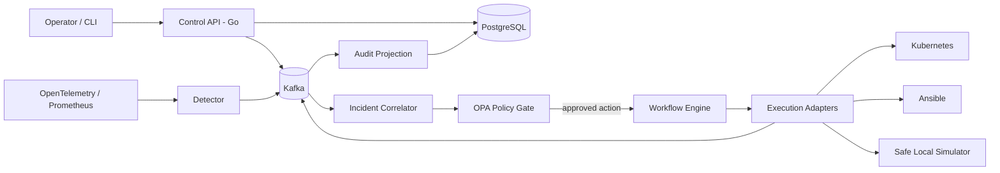
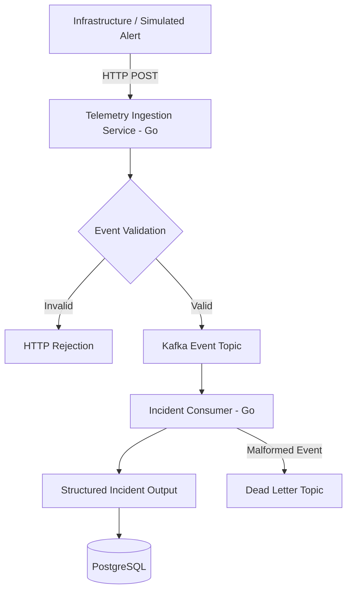
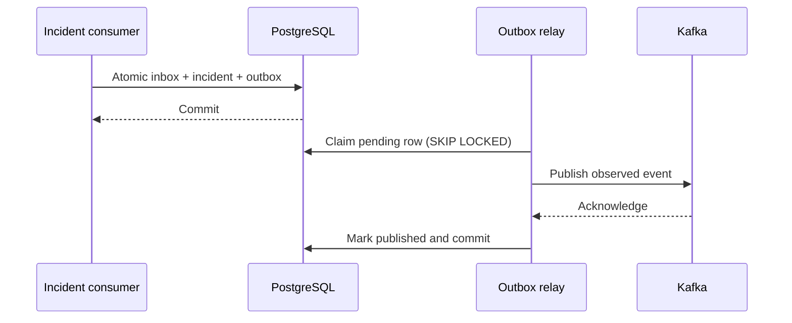
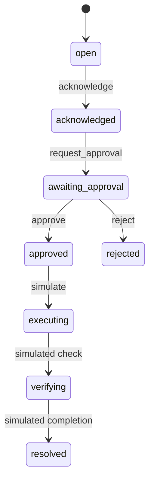
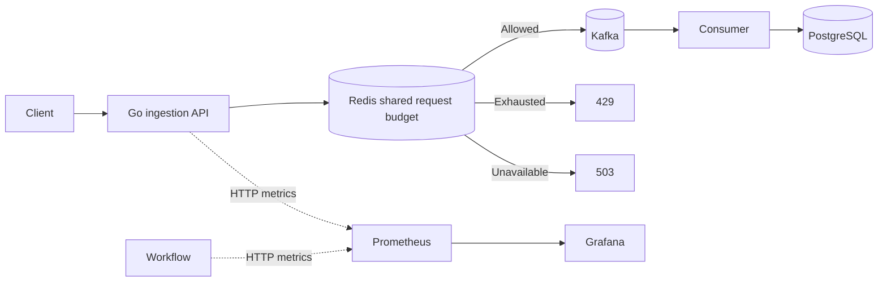
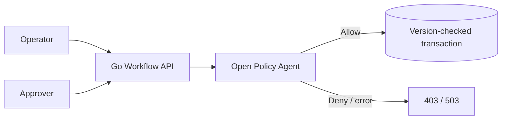
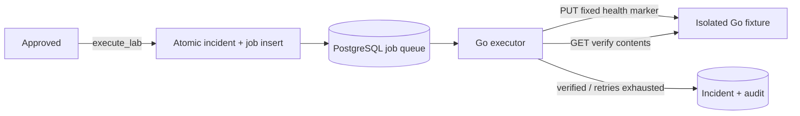

# AETHER
### Autonomous Event-driven Telemetry, Execution & Resilience

> **Status: Phase 4/5 prototype — durable events, admission control and approval simulation.** AETHER is an experimental, local-first DevOps platform. Automated remediation is intentionally restricted to explicitly approved, allowlisted actions; this repository is not production-ready.

**AETHER** is an open-source engineering project exploring how observable infrastructure events can become auditable, policy-gated operational workflows. It is built around a service-oriented control plane rather than a single dashboard.

## Quick start (local lab)

```bash
export AETHER_OPERATOR_TOKEN="$(openssl rand -hex 32)"
export AETHER_APPROVER_TOKEN="$(openssl rand -hex 32)"
make up
make smoke
make automation
make down
```

See [local demo runbook](docs/runbooks/local-demo.md) for prerequisites, limitations and cleanup. See the verification matrix below for the last successful runs and remaining checks. Do not expose local ports publicly.

## Why this exists

Modern infrastructure produces alerts, logs and events, but humans often still have to correlate them, select a runbook, execute it and verify the result. AETHER aims to make this process reproducible: **observe → normalize → correlate → decide → approve → execute → verify → audit**.

### Design principles
- **Safety before autonomy**: start in dry-run mode; no destructive or production actions by default.
- **Events are not commands**: Kafka delivers facts, while a policy-controlled orchestrator authorizes commands.
- **State is explicit**: PostgreSQL stores workflow/incident state, Kafka distributes events, Redis is optional for ephemeral coordination.
- **Adapters over vendor lock-in**: execution backends can target Kubernetes, Ansible, Docker or cloud-compatible APIs.
- **Local-first**: Docker Compose and k3d/kind are development targets; Floci/LocalStack are optional integration-test dependencies.
- **Evidence over claims**: all features are labelled implemented, planned, or experimental.

## System overview


The visual below is the planned event-to-action pipeline; it does **not** imply the entire platform is implemented.




> Diagram describes **target architecture**, not a claim that all components are implemented.

## Initial repository layout

| Path | Purpose |
| --- | --- |
| `services/control-api/` | Go HTTP API and health endpoints |
| `docs/architecture/` | Architecture diagrams and decisions |
| `docs/roadmap.md` | Milestones and acceptance criteria |
| `contracts/events/` | Versioned event schemas |
| `deploy/compose/` | Local development infrastructure |
| `.github/workflows/` | CI automation |

## Planned implementation sequence

1. **Foundation** — documentation, architecture decisions, Go control API, tests and CI.
2. **Event fabric** — Kafka with structured event contracts, consumer idempotency and retry/DLQ semantics.
3. **Incident lifecycle** — PostgreSQL persistence, state machine, audit projection and correlation.
4. **Policy & execution** — authorization, dry-run engine, allowlisted adapters and approvals.
5. **Observability** — OpenTelemetry, Prometheus, Grafana, logging and SLOs.
6. **Delivery & resilience** — Kubernetes/Helm, GitOps, failure injection and measured recovery.

See [roadmap](docs/roadmap.md) and [architecture](docs/architecture/overview.md).

## Languages & technologies

Core services use **Go** (with room for Java/C++ adapters). Infrastructure uses Docker, Kubernetes, Kafka, PostgreSQL, OpenTofu/Terraform and Ansible as milestones are implemented. Optional local cloud emulators are **not prerequisites** for development.

## Safety and scope

Do not expose this prototype directly to the public internet. Credentials, access controls, persistence, policy enforcement and execution isolation require hardening. AETHER does not run privileged remediation automatically without explicit policy and operator approval.

## Contributing

See [CONTRIBUTING.md](CONTRIBUTING.md). Architecture decisions should be documented before changing cross-service contracts.

## License

Apache License 2.0 — see [LICENSE](LICENSE).

## Event fabric preview (Phase 2)

The Go ingestion and consumer processes, Kafka Compose environment and smoke test are available on main. Runtime verification is pending. See [event fabric architecture and local run instructions](docs/architecture/event-fabric.md).

### Event ingestion and processing flow



### Kafka architecture


*Implemented event-processing design. Runtime verification pending.*

Events are routed using their correlation IDs as partition keys. Malformed broker messages are sent to a dead-letter topic before their consumer offsets are committed.

### Overall AETHER development roadmap

| Phase | Milestone | Status |
| --- | --- | --- |
| 01 | Repository, architecture and control API | Committed |
| 02 | Kafka event fabric | Prior end-to-end CI passed |
| 03 | PostgreSQL incident management | Prior PostgreSQL and workflow integration CI passed |
| 04 | Redis caching and coordination | Shared admission budget; prior integration CI passed |
| 05 | Workflow orchestration and policy engine | OPA and default lab execution verified in prior CI |
| 06 | Ansible and Puppet automation | Standalone and approved Ansible/Puppet adapter CI passed |
| 07 | Floci / LocalStack cloud adapters | LocalStack S3 evidence round-trip CI passed |
| 08 | Kubernetes, Helm and GitOps | Helm/kind and Argo CD sync/self-healing CI passed |
| 09 | Prometheus, Grafana and OpenTelemetry | HTTP metrics, dashboard and HTTP-to-Kafka tracing verified in prior CI |
| 10 | Chaos engineering and security | OPA and Redis outage drills CI passed; broader chaos/security pending |

## Durable event processing



**Guarantee:** at-least-once delivery with transactional inbox deduplication. No end-to-end exactly-once claim. See [failure model](docs/architecture/outbox-relay.md). Runtime verification is pending.

## Approval-gated workflow (local simulation)



The opt-in workflow API uses distinct operator/approver bearer tokens, OPA authorization, version checks and atomic audit inserts. Simulation does not perform any infrastructure changes or prove real recovery. See [workflow architecture and limitations](docs/architecture/workflow.md).

```bash
export AETHER_OPERATOR_TOKEN="$(openssl rand -hex 32)"
export AETHER_APPROVER_TOKEN="$(openssl rand -hex 32)"
docker compose -f deploy/compose/events.yaml --profile workflow up -d --build
bash tests/event-fabric-smoke.sh
bash tests/workflow-smoke.sh
```

**Verification:** [GitHub Actions run 45892838506](https://github.com/ABHILASH9519/Project-Aether-Autonomous-Infrastructure-Orchestrator/actions/runs/45892838506) passed the prior Kafka/PostgreSQL/Docker workflow baseline. [Run 45893095275](https://github.com/ABHILASH9519/Project-Aether-Autonomous-Infrastructure-Orchestrator/actions/runs/45893095275) also passed Redis and monitoring checks. OPA authorization and recovery also passed in run 45894817663. No production deployment or real remediation is supported yet.

## Admission control and observability



```bash
export AETHER_OPERATOR_TOKEN="$(openssl rand -hex 32)"
export AETHER_APPROVER_TOKEN="$(openssl rand -hex 32)"
docker compose -f deploy/compose/events.yaml --profile workflow --profile observability up -d --build
```

- Redis admission: 120 requests per fixed 60-second window shared by ingestion replicas; fail closed on Redis failure.
- Prometheus: http://localhost:9090
- Grafana: http://localhost:3000 (local anonymous viewer, provisioned AETHER HTTP operations dashboard)
- Metrics: http://localhost:8081/metrics and http://localhost:8082/metrics

See [admission design](docs/architecture/admission.md) and [observability design](docs/architecture/observability.md). Metrics do not contain request IDs or payloads. The optional monitoring profile is local only; prior monitoring smoke tests passed. HTTP-to-Kafka OpenTelemetry tracing is now optional; worker metrics and alerts remain planned.

## Policy-based authorization



Operators request approval and simulate; approvers approve or reject. OPA denies unknown actions and live execution. See [policy architecture](docs/architecture/policy.md). Two distinct tokens are required for the workflow profile. [Policy and outage integration CI passed](https://github.com/ABHILASH9519/Project-Aether-Autonomous-Infrastructure-Orchestrator/actions/runs/45894817663). Audit rows record the server-derived role. See the [local OPA outage drill](docs/runbooks/policy-outage.md) for fail-closed behavior and recovery.

## Durable lab execution



The `execute_lab` action queues an approved job. A separate worker applies an idempotent repair to an isolated synthetic fixture and independently verifies the contents. Three recorded attempts are allowed. Fixture state is ephemeral; this is not real production infrastructure remediation. See [execution architecture](docs/architecture/execution.md). Inspect job evidence via authenticated `GET /api/v1/incidents/{id}/job`. Run `bash tests/execution-smoke.sh` with the workflow profile. Default fixture execution passed in run 45897898366; newer adapters require separate verification.

## Configuration management lab

Ansible and Puppet enforce a version-controlled desired configuration, demonstrate idempotence, and correct injected drift inside a disposable container. See [architecture and run instructions](docs/architecture/configuration-management.md). An optional Compose overlay connects a fixed Ansible/Puppet reconciliation adapter to the approved execution worker; see the linked guide.

## Kubernetes deployment

A local Helm chart deploys the six event-fabric processes and their dependencies; a kind CI job checks the approved workflow and lab repair. An Argo CD Application with automatic sync and self-healing, a scoped AppProject, and a dedicated GitOps integration workflow are included. See [Kubernetes architecture and setup](docs/architecture/kubernetes.md). The chart now uses separate PostgreSQL and Kafka persistent volume claims by default; pod replacement recovery testing is configured. Images remain locally loaded, not registry-promoted.

## Distributed tracing

Set `AETHER_OTLP_ENDPOINT=http://jaeger:4318/v1/traces` before starting the observability profile. Jaeger listens on http://localhost:16686. W3C trace headers connect HTTP ingestion to Kafka consumer spans. See [trace architecture](docs/architecture/tracing.md). HTTP-to-Kafka tracing passed in run 45897963370; outbox and execution spans are not yet connected.

## Local cloud evidence archive

The opt-in `cloud` Compose profile uses LocalStack S3 to archive verified remediation evidence. The smoke script exports authenticated job metadata and checks a byte-for-byte download. See [local cloud lab](docs/architecture/cloud-evidence.md). This is an explicit lab export, not continuous cloud archival; no live AWS account is required.

## Failure drills

The local suite includes [OPA outage and recovery](docs/runbooks/policy-outage.md) and [Redis fail-closed outage and recovery](docs/runbooks/redis-outage.md). These deliberately stop disposable local services; never run them against production.

## Verification matrix

| Scope | Verified commit / run |
| --- | --- |
| Default execution and retry tests | [ba06c97 / CI](https://github.com/ABHILASH9519/Project-Aether-Autonomous-Infrastructure-Orchestrator/actions/runs/45897898366) |
| HTTP-to-Kafka trace propagation | [29462c9 / CI](https://github.com/ABHILASH9519/Project-Aether-Autonomous-Infrastructure-Orchestrator/actions/runs/45897963370) |
| Local Kubernetes workflow and execution | [ba06c97 / CI](https://github.com/ABHILASH9519/Project-Aether-Autonomous-Infrastructure-Orchestrator/actions/runs/45897898363) |
| Standalone Ansible/Puppet drift reconciliation | [11750b4 / CI](https://github.com/ABHILASH9519/Project-Aether-Autonomous-Infrastructure-Orchestrator/actions/runs/45898062606) |
| LocalStack evidence export | [ada3bfb / CI](https://github.com/ABHILASH9519/Project-Aether-Autonomous-Infrastructure-Orchestrator/actions/runs/45898190136) |
| Redis outage recovery and cloud smoke | [ada3bfb / CI](https://github.com/ABHILASH9519/Project-Aether-Autonomous-Infrastructure-Orchestrator/actions/runs/45898190136) |
| Approved Ansible/Puppet adapter | [ada3bfb / CI](https://github.com/ABHILASH9519/Project-Aether-Autonomous-Infrastructure-Orchestrator/actions/runs/45898190166) |
| Argo CD sync and replica self-healing | [34e1f7d / CI](https://github.com/ABHILASH9519/Project-Aether-Autonomous-Infrastructure-Orchestrator/actions/runs/45901613370) |

These runs validate particular commits, not every later change. The project remains a local engineering lab; production HA, identity, durable Kubernetes storage, live cloud execution, full trace coverage and registry-based image promotion remain outside the verified scope.

## GitOps reconciliation

The dedicated Argo CD workflow installs a pinned controller, deploys the exact commit through Git (not Helm install), runs approval and execution smoke tests, and checks recovery from replica drift. See [GitOps architecture and local setup](docs/architecture/gitops.md). Automated pruning is disabled. Controller integration passed in [run 45901613370](https://github.com/ABHILASH9519/Project-Aether-Autonomous-Infrastructure-Orchestrator/actions/runs/45901613370): the exact Git revision synced successfully, the approved workflow completed, and Argo CD restored the fixture from zero to one replica.

## Kubernetes persistence

The Helm chart now provisions PostgreSQL and Kafka PVCs by default. Use a fresh namespace when switching from the previous emptyDir setup; no automatic data migration is provided. Claims are retained on Helm uninstall and excluded from Argo CD prune/delete. Deleting a namespace can still destroy data. Single-node storage is not HA or backup. See [Kubernetes guide](docs/architecture/kubernetes.md).

The [persistence recovery drill](docs/runbooks/kubernetes-persistence.md) compares incident/job state and Kafka partition end offsets before and after real pod replacement. New CI verification pending.

## Database recovery

The [PostgreSQL restore drill](docs/runbooks/postgres-restore.md) creates a logical backup and restores it into a separate temporary database. It checks the incident, remediation evidence, audit, inbox and outbox records without overwriting the source. This local test is not a coordinated Kafka/PostgreSQL recovery plan. CI verification pending.

## Schema lifecycle

An ordered, checksummed [migration ledger](docs/architecture/migrations.md) now prevents repeated DDL on service startup, serializes concurrent replicas and rejects schema checksum mismatches. CI covers concurrent startup and stable constraint identity; new verification pending.
