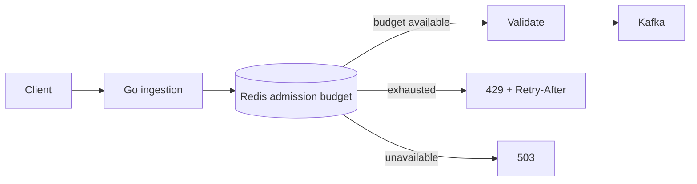

# Redis-backed admission control

A shared Redis counter limits POST /api/v1/events across ingestion replicas. Redis Lua executes INCR and first-use expiry atomically. The window starts on the first request and expires 60 seconds later. The local default budget is 120 requests per window.

Fail closed when configured Redis is unavailable. Health and metrics endpoints bypass admission. Redis is not the authoritative incident store; a restart can reset the budget. This is a global fixed-window cap, not a rolling rate limit or tenant quota; boundary bursts are possible. Invalid requests consume capacity too. Direct Kafka producers bypass HTTP admission. The local Redis instance is not exposed to the host and is not configured for production authentication or HA.

Run using the default event Compose stack; REDIS_ADDR is optional for standalone ingestion. Unit tests cover allowed, rejected and unavailable decisions. Redis runtime behavior requires integration verification.
