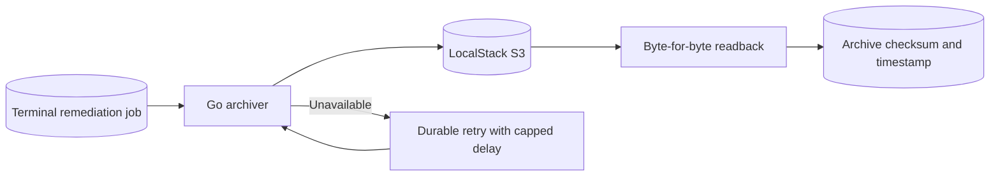

# Automatic LocalStack S3 evidence archive

The optional cloud profile runs a Go archive worker. Terminal remediation jobs become eligible through PostgreSQL migration 3. The worker claims a job, serializes the exact job API JSON, writes it to a fixed emulator bucket, reads it back, verifies byte equality, and records the SHA-256 and archive timestamp. The integration smoke only reads S3 and verifies the stored checksum; it no longer performs the upload itself.

The adapter deliberately supports only the internal LocalStack endpoint with fixed dummy credentials and a fixed bucket. It implements the small required path-style S3 SigV4 request subset, not a general AWS client. No real AWS credentials or public targets are accepted. The emulator has ephemeral object storage; a successful archive records historical delivery and does not guarantee the object survives emulator destruction. Retention, production IAM, encryption, rehydration and Kubernetes cloud-worker deployment remain outside the verified scope. Previous explicit export passed; automatic worker verification pending.
