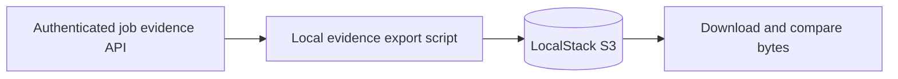

# Local cloud evidence archive

The optional LocalStack S3 lab exports authenticated remediation job evidence from the workflow API and verifies a byte-for-byte object round trip. The smoke script uses awslocal inside the emulator container, not real AWS credentials. No cloud bill or public endpoint is needed.



Run using a disposable local stack:

```sh
export AETHER_OPERATOR_TOKEN="$(openssl rand -hex 32)"
export AETHER_APPROVER_TOKEN="$(openssl rand -hex 32)"
export AETHER_EXECUTION_ID="cloud-demo-$(date +%s)"
docker compose -f deploy/compose/events.yaml --profile workflow --profile cloud up -d --build
bash tests/execution-smoke.sh
bash tests/cloud-evidence-smoke.sh
```

The export is explicit, not an automatically delivered archive. LocalStack is ephemeral in this profile; object lifecycle, immutable retention, encryption and production IAM are not implemented. The script uses synthetic incident data and a fixed local bucket. CI verification pending.
