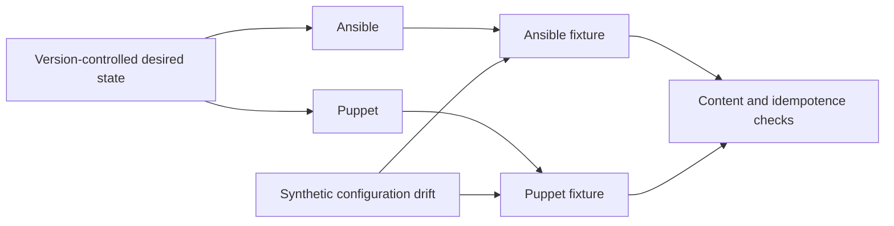

# Configuration management lab

Ansible and Puppet manage distinct synthetic configuration files inside a disposable container. Both enforce the same desired state, run twice to establish convergence, then repair injected drift. No host mounts, remote SSH credentials, Docker socket or privileged runtime are required.



```sh
docker build -t aether-automation:local automation
docker run --rm --network none --cap-drop ALL --security-opt no-new-privileges aether-automation:local
```

The standalone lab tests convergence and drift. An optional Compose overlay also selects a fixed Ansible/Puppet reconciliation backend for the approved execution worker. No event-supplied commands or paths are accepted. The fixture reads both configuration files back before reporting verification. This backend manages one shared synthetic configuration per container, not separate external hosts. Package resolution uses Debian bookworm repositories during build; runtime is network-isolated. CI verification pending.

## Approved execution adapter

```sh
export AETHER_OPERATOR_TOKEN="$(openssl rand -hex 32)"
export AETHER_APPROVER_TOKEN="$(openssl rand -hex 32)"
docker compose -f deploy/compose/events.yaml -f deploy/compose/automation.yaml --profile workflow up -d --build
bash tests/execution-smoke.sh
```

The overlay increases the worker's bounded repair timeout to 45 seconds; the database job lock is held during this operation. The reconciliation command is fixed at image build time. The ordinary fixture backend remains the default. Do not run the two profiles concurrently against the same ports or database. Adapter CI verification is pending.
