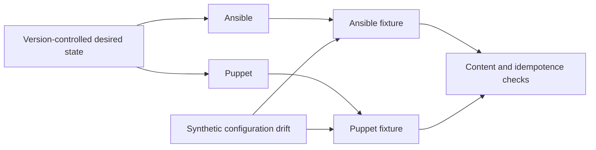

# Configuration management lab

Ansible and Puppet manage distinct synthetic configuration files inside a disposable container. Both enforce the same desired state, run twice to establish convergence, then repair injected drift. No host mounts, remote SSH credentials, Docker socket or privileged runtime are required.



```sh
docker build -t aether-automation:local automation
docker run --rm --network none --cap-drop ALL --security-opt no-new-privileges aether-automation:local
```

This is a standalone configuration-management lab, not an executor backend. Automated dispatch of Ansible/Puppet from the approval workflow remains a separate integration task. Package resolution uses Debian bookworm repositories during build; runtime is network-isolated. CI verification pending.
