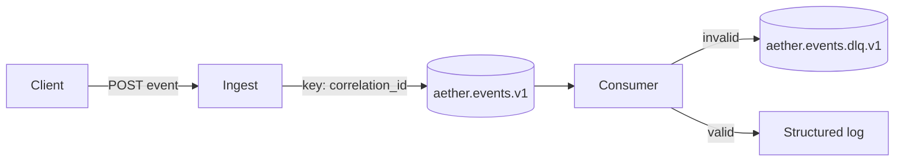

# Event fabric — Phase 2

Two independent Go processes share an event contract, not a database. The ingestion service validates JSON and waits for Kafka acknowledgement before returning HTTP 202. The consumer logs an incident preview and commits offsets after processing. Malformed broker records go to a dead-letter topic before offset commit.



## Run locally

From repository root:

```sh
docker compose -f deploy/compose/events.yaml up -d --build
bash tests/event-fabric-smoke.sh
docker compose -f deploy/compose/events.yaml logs consumer
docker compose -f deploy/compose/events.yaml down
```

## Guarantees and limitations

- At-least-once delivery; retries can duplicate events. No durable deduplication yet.
- Ordering is per Kafka partition, keyed by correlation ID.
- Single-node KRaft broker is for development only, not highly available.
- HTTP ingestion is loopback-bound in Compose and has no authentication yet.
- Consumer output is a preview, not a durable incident record.
- DLQ may contain untrusted input; use synthetic data only.
- Dependency checksums are generated during build; commit a verified go.sum before release.
- CI and runtime behavior must be verified before claiming successful integration.

Next: PostgreSQL inbox/outbox, incident state machine and durable idempotency.
