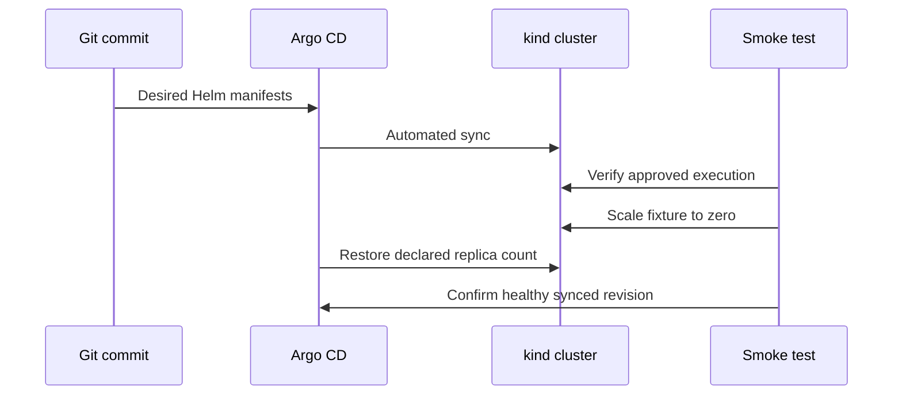

# Argo CD deployment and drift recovery

Argo CD is installed in a disposable kind cluster by the GitOps CI workflow using the pinned upstream v3.6.3 installation manifest, kind v0.30.0 and its digest-pinned Kubernetes v1.34.0 image (within the upstream tested Kubernetes range). The AppProject limits the source repository, destination namespace, and permitted resource kinds. The application controller renders the Helm chart from Git and syncs it into the pre-created namespace. Automated self-healing is enabled; pruning is intentionally disabled.



CI pins the Application source to the exact checked-out commit and preloads the matching local image. No Helm install is used to create the application workload in this job. The test requires a healthy, synced revision and successful operation, runs the Kubernetes workflow/repair smoke tests, then injects replica drift and checks self-healing.

## Local use

In a fresh, disposable kind cluster named aether using Kubernetes 1.34 or another upstream-tested version, build and preload the image and create the target namespace and Secret using the [Kubernetes guide](kubernetes.md), **without** running Helm install. Install Argo CD and apply the project and application:

```bash
kubectl create namespace argocd
kubectl apply -n argocd --server-side --force-conflicts -f https://raw.githubusercontent.com/argoproj/argo-cd/v3.6.3/manifests/install.yaml
kubectl wait --for=condition=Established crd/applications.argoproj.io crd/appprojects.argoproj.io --timeout=120s
kubectl apply -f deploy/gitops/project.yaml
kubectl apply -f deploy/gitops/application.yaml
kubectl -n argocd get application aether-local
```

The committed Application tracks main. For reproducible local tests, patch targetRevision to the exact Git SHA corresponding to the loaded image and export AETHER_GIT_REVISION before running tests/gitops-smoke.sh. Do not deploy this over a separately Helm-managed release. This is a local lab: installing Argo CD requires cluster admin access; the application project scope is not a replacement for cluster security controls. CI does not test production credential management, pruning, promotion, HA, or a container registry.
