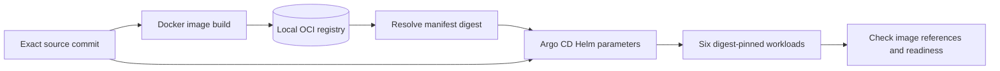

# Immutable local image delivery

The GitOps workflow builds the event-fabric image from the checked-out commit, publishes it to an ephemeral loopback registry, resolves the manifest digest and passes that digest into Argo CD Helm parameters. The controller deploys all six Go processes with the immutable repository@sha256 reference. CI verifies the expected image reference and ready containers after Git sync and self-healing.

The registry binds only to host loopback and is attached to the disposable kind Docker network; containerd maps localhost:5001 to that registry following the [kind local registry guide](https://kind.sigs.k8s.io/docs/user/local-registry/). It has no authentication or TLS and must never be publicly exposed. CI removes it afterward. No GHCR publication, external credentials, release tags or public artifact promotion are performed. The default Helm path still uses the preloaded local image. Digest pinning establishes immutable deployment identity, not bit-for-bit reproducibility; base image digests and full dependency lock verification remain future work. CI verification pending.

Registry lookup accepts both OCI/Docker indexes and single-image manifests and verifies the downloaded bytes against the registry-reported SHA-256. The first registry CI run failed after a successful push because its media-type negotiation was too narrow; corrected run pending.

The first digest-resolved runs exposed a separate containerd pull error: Kubernetes resolved the registry alias to its own loopback. CI now explicitly sets the containerd 2.x CRI registry configuration path, writes a registry-specific HTTP endpoint using the disposable registry's kind-network IP, and verifies the immutable pull via crictl on each node before installing Argo CD. The image remains configured with pullPolicy Always; preflight tests registry connectivity, not a fallback to preloading. See https://github.com/containerd/containerd/blob/main/docs/hosts.md. Corrected CI pending.
