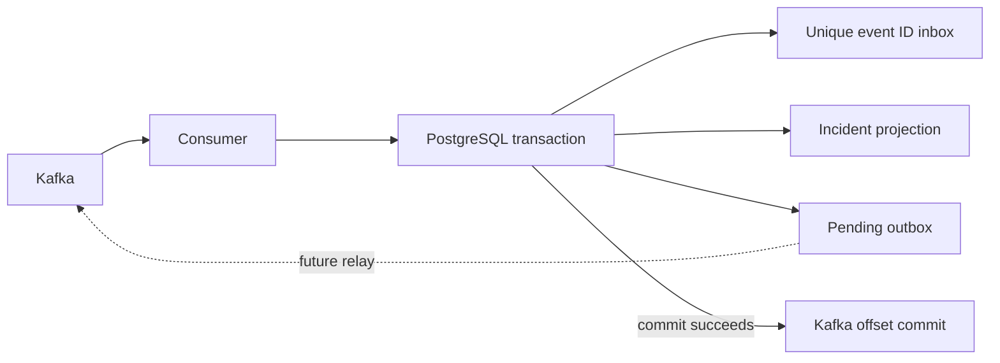

# Incident persistence — Phase 3

Status: initial storage implementation; integration verification pending.

The inbox, incident update and outbox insertion are atomic. A replay after database commit but before Kafka offset commit is ignored by the unique inbox key. The current projection counts events by correlation ID; it does not yet implement incident state transitions. Outbox publishing is not implemented. Event IDs must be globally unique; conflicting reuse of an ID is currently treated as a duplicate. PostgreSQL is intended for local development; authentication and operational hardening remain pending.
