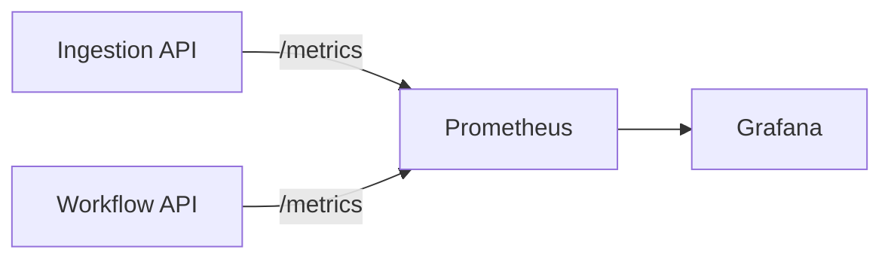

# HTTP observability

Ingestion and workflow expose /metrics using bounded status-class labels. Prometheus scrapes each instance. No URL, incident ID, token or payload is included in metric labels.

Query request throughput: `sum by (job) (rate(aether_http_requests_total[5m]))`.

Query errors: `sum by (job) (rate(aether_http_requests_total{status_class="5xx"}[5m]))`.

Average request latency: `sum by(job)(rate(aether_http_request_duration_seconds_total[5m])) / clamp_min(sum by(job)(rate(aether_http_requests_total[5m])), 0.000001)`.

These are process-local counters, not distributed traces or latency percentiles. Worker metrics, histogram buckets and OpenTelemetry remain future work.
