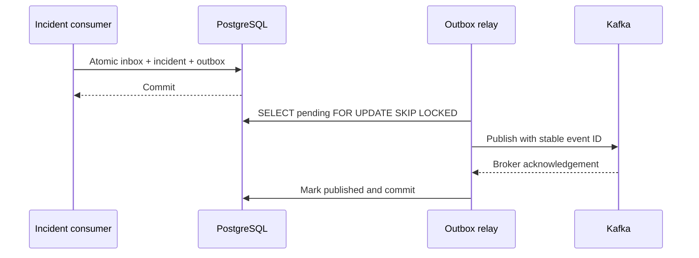

# Transactional outbox relay

Status: implementation committed; runtime verification pending.

## Failure model

| Failure | Expected behavior |
| --- | --- |
| Broker unavailable | Roll back relay transaction; retry after delay |
| Relay crashes before publish | Database releases row lock |
| Relay crashes after broker ack | Record may be published again |
| Multiple relay replicas | SKIP LOCKED prevents concurrent claims of the same row |

Delivery is at least once. Downstream consumers must deduplicate using event_id. The output topic carries the original observed event envelope, not a new incident-state transition. Multiple workers do not guarantee ordering across records of the same incident. A database row lock is held during bounded network I/O; a lease-based relay is a future scaling option. No retention policy or poison-record quarantine is implemented yet.
