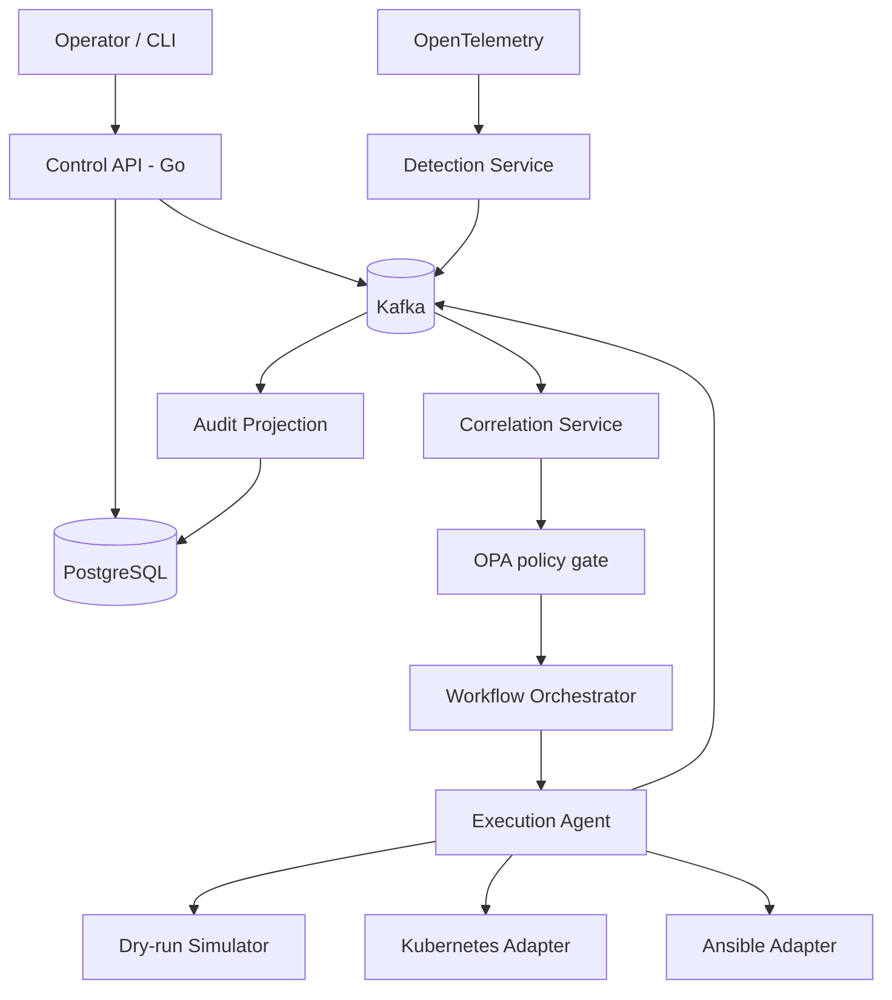

# AETHER architecture overview

> **Status:** target design. Only components explicitly marked implemented in the [roadmap](../roadmap.md) are functional.

## System context

## Service boundaries

| Service | Language | Ownership | Phase |
| --- | --- | --- | --- |
| Control API | Go | HTTP interface, request validation, health endpoints | 1 |
| Telemetry Ingest | Go | Normalize incoming alerts and telemetry into events | 2 |
| Incident Correlator | Go | Group signals into incidents, retain evidence | 3 |
| Workflow Orchestrator | Go | Durable incident state machine and commands | 3 |
| Policy Gate | Go + OPA | Authorize execution proposals and approvals | 4 |
| Execution Agent | Go | Idempotent, least-privilege execution adapters | 4 |
| Audit Projection | Go | Persist append-only action records | 3 |

Services may be separated at deployment time as load and ownership justify it; avoid premature microservice proliferation.

## Messaging and reliability

- Every event has `event_id`, `event_type`, `schema_version`, `occurred_at`, `source` and `correlation_id`.
- Event payloads are versioned; consumers must tolerate additive optional fields.
- Producer uses transactional outbox when writing both a database state change and an outbound event.
- Consumer effects are idempotent using `event_id` deduplication in persistent storage.
- Retries are bounded, followed by DLQ and operator review; replay is explicit.
- Kafka is an at-least-once transport in this design, **not** a global exactly-once guarantee.
- Partition keys use a stable incident ID where ordering matters.

## Operational safety

1. Detection produces a **fact**, never a privileged instruction.
2. Policy evaluation and approval produce an authorized execution command.
3. Commands require resource scoping, action allowlists and time-limited authorization.
4. Execution defaults to dry-run and records every attempt.
5. Verification is a distinct step; failed verification leaves incident open.
6. A kill switch stops dispatching commands; manual intervention remains possible.

## Data model (planned)

- PostgreSQL: incidents, state transitions, approvals, execution attempts, audit trail, outbox and inbox/deduplication.
- Kafka: immutable event envelopes and replayable stream (within retention).
- Redis: optional bounded caches and ephemeral coordination only.
- S3-compatible object storage: diagnostic artifacts (later).
- Prometheus/Loki: metrics and logs, not authoritative workflow state.

## Dependency philosophy

The control API is designed to start independently. Kafka, PostgreSQL and cloud emulators are optional in Phase 1 and must not be falsely represented as integrated. External free APIs may provide nonessential demo signals through a dedicated adapter; see [integrations](../integrations/public-apis.md).
