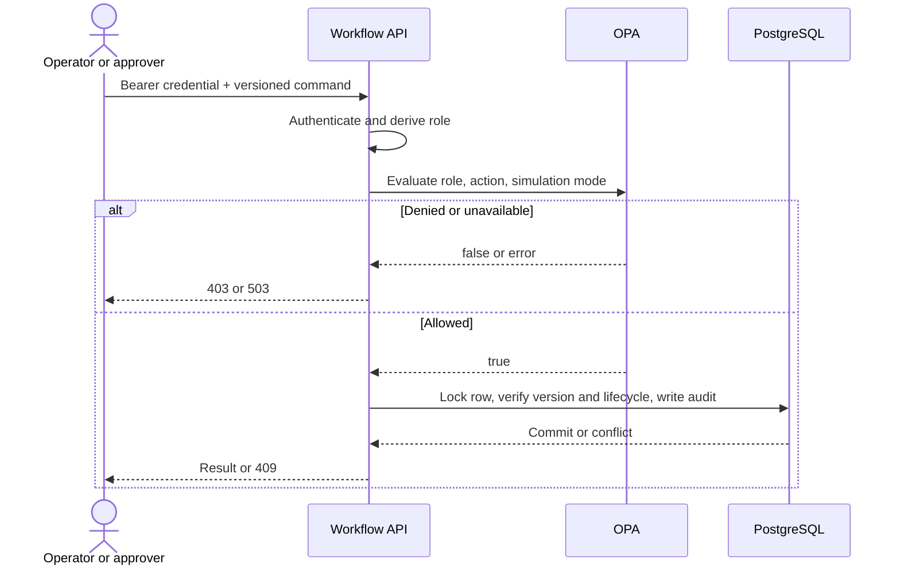

# Policy decision boundary

The workflow process authenticates two distinct local bearer credentials. Only operators acknowledge, request approval and simulate; only approvers approve or reject. OPA denies unknown roles, actions and non-simulation mode. No user-supplied role or execution mode is trusted. OPA is reachable only on the Compose network. State legality and optimistic version checks remain inside the database transaction, independent of policy availability.

This is role separation, not individual identity or proof that two different humans participated. Shared secrets are local-only; TLS, identity-provider integration, policy revision audit and per-resource authorization remain open. The workflow cannot run real remediation. Unavailable, undefined or malformed decisions fail closed with 503; explicit policy denial returns 403.

Set distinct random AETHER_OPERATOR_TOKEN and AETHER_APPROVER_TOKEN before enabling the workflow profile.

The committed audit records include the server-derived actor role. Existing records migrate to `legacy`; no historical identity is inferred. Tests check rejected identical credentials, policy outage and persisted approval-role attribution.
