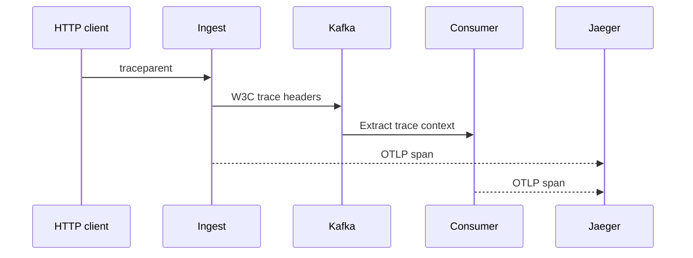

# OpenTelemetry tracing

The optional OTLP exporter sends spans to the local Jaeger service. W3C trace context crosses HTTP ingestion and Kafka message headers into the incident consumer. No payload, correlation ID, bearer token, or baggage is included. The Jaeger smoke test submits a known trace ID and checks both spans exist.

Enable with `export AETHER_OTLP_ENDPOINT=http://jaeger:4318/v1/traces` and start the workflow and observability profiles. Browse http://localhost:16686. Tracing now persists W3C traceparent in the outbox and remediation job tables through additive migration 2. The relay resumes the consumer trace, and the executor resumes the separate authenticated workflow command trace. Existing records with empty parents create new roots. The two paths are not automatically joined into one incident-wide trace. Local sampling accepts parent sampling decisions and samples new roots. No production collector or TLS is configured. Prior ingestion tracing passed. New durable-boundary verification pending.
