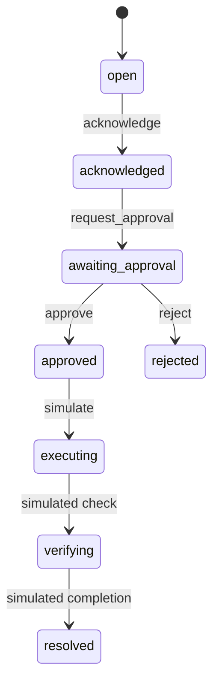

# Incident lifecycle and simulation

The workflow API is a separate Go process. It shares the incident database with the projection consumer as an intentional initial deployment boundary, not independent database ownership.



Each command requires the caller's last observed version. PostgreSQL locks the incident row, compares the version, validates the state transition, inserts audit records and updates state in one transaction. Conflicts return HTTP 409. Event ingestion increments event count independently of the lifecycle version. Repeated event observations do not reopen resolved incidents.

Simulation commits all three final transitions atomically; it does not access Kubernetes, run scripts, verify real infrastructure or claim real recovery. The audit table is append-only at application level, not tamper-proof. Distinct operator and approver tokens authenticate roles; OPA authorizes actions. Individual identities and TLS are not implemented. See [policy design](policy.md). Use only a local environment.

## Run

```bash
export AETHER_OPERATOR_TOKEN="$(openssl rand -hex 32)"
export AETHER_APPROVER_TOKEN="$(openssl rand -hex 32)"
docker compose -f deploy/compose/events.yaml --profile workflow up -d --build
bash tests/event-fabric-smoke.sh
bash tests/workflow-smoke.sh
```

The workflow smoke test requires curl and jq. Keep both distinct tokens exported for Compose and smoke tests. Never commit the token. The API is bound to loopback on port 8082.

| Method | Route | Behavior |
| --- | --- | --- |
| GET | /healthz | Process liveness |
| GET | /api/v1/incidents/{id} | Incident state, version and count |
| POST | /api/v1/incidents/{id}/transitions | Apply version-checked command |

Transition request: `{"expected_version":0,"action":"acknowledge"}`. Send `Authorization: Bearer <token>` on protected endpoints.

Verification status: pure lifecycle tests passed on a local reproduction of the source. Prior database, HTTP and Compose tests passed; new policy integration requires verification.
